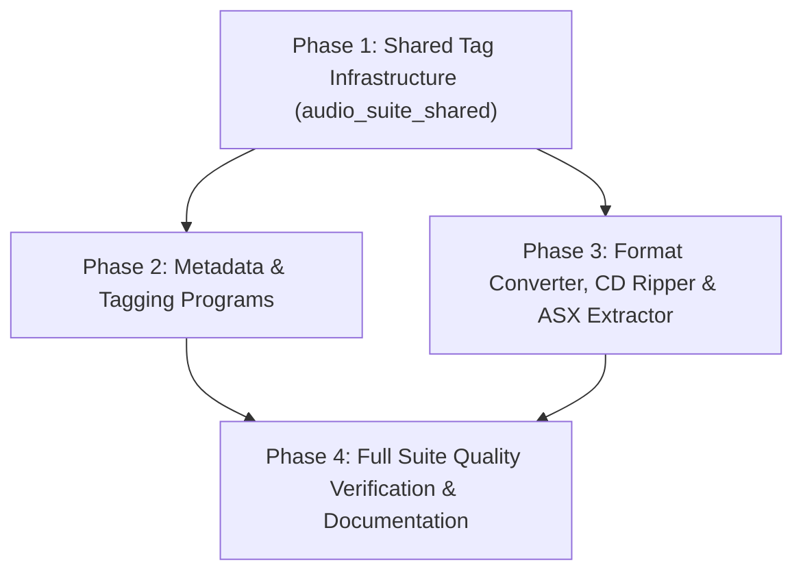

# PLAN: Format Support Expansion across AudioSuite-Pro

**Date:** 2026-09-20  
**Target:** Eliminate format support gaps across all AudioSuite-Pro programs by standardising on `audio_suite_shared.audio_formats.SUPPORTED_EXTENSIONS`.

**Status:**
- Phase 1: ✅ COMPLETE
- Phase 2: ✅ COMPLETE
- Phase 3: ✅ COMPLETE
- Phase 4: ✅ COMPLETE

---

## 1. Executive Summary & Objective

In [`audio_suite_shared/audio_formats.py`](audio_suite_shared/audio_formats.py), AudioSuite-Pro establishes a canonical standard of **9 supported audio file extensions**:
```python
SUPPORTED_EXTENSIONS: tuple[str, ...] = (
    ".mp3",  # MPEG-1 Audio Layer 3
    ".flac",  # Free Lossless Audio Codec
    ".ogg",  # Ogg Vorbis
    ".m4a",  # MPEG-4 Audio (AAC)
    ".mp4",  # MPEG-4 Container (AAC audio)
    ".opus",  # Opus Audio Codec
    ".wav",  # Waveform Audio File Format
    ".aiff",  # Audio Interchange File Format
    ".aif",  # Audio Interchange File Format (short)
)
```

While 19 suite programs already support the full 9 formats, an audit revealed **6 primary programs**, **1 playlist utility**, and **1 auxiliary CLI script** with format restrictions:

1. **Album Genre Tagger** (`album_genre_tagger`) — Supports only **1 of 9** (`.mp3`).
2. **Album Art Normalizer** (`album_art_normalizer`) — Supports only **2 of 9** (`.mp3`, `.flac`).
3. **Metadata Scrubber** (`metadata_scrubber`) — Supports only **5 of 9** (`.mp3`, `.flac`, `.ogg`, `.m4a`, `.mp4`).
4. **Tag Field Updater** (`tag_field_updater`) — Supports only **5 of 9** (`.mp3`, `.flac`, `.ogg`, `.m4a`, `.mp4`).
5. **Music Format Converter** (`music_format_converter`) — Supports only **6 of 9** (`.mp3`, `.flac`, `.ogg`, `.m4a`, `.opus`, `.wav`).
6. **CD Ripper** (`cd_ripper`) — Output formats support **6 of 9** (`.flac`, `.mp3`, `.ogg`, `.m4a`, `.opus`, `.wav`).
7. **ASX Playlist Extractor** (`asx_extractor`) — Fallback search swap logic strictly supports **2 of 9** (`.mp3` ↔ `.flac`).
8. **Recursive Music Art Resizer** (`utilities/resize_music_recursive.py`) — Supports only **5 of 9** (`.mp3`, `.flac`, `.ogg`, `.m4a`, `.mp4`).

**Goal:** Expand every deficient program to support the full set of canonical formats, while maintaining 100% backward compatibility, strict type safety (`mypy --strict`), zero Bandit security warnings, and full test coverage.

---

## 2. Gap Analysis & Architecture Breakdown

### 2.1. Shared Tag Helper Foundation (`audio_suite_shared`)
* **Current state:**
  * `TagHandlerFactory` in [`tag_helper_base.py`](audio_suite_shared/tag_helper_base.py) maps all 9 extensions (`.mp3` → `MP3Handler`, `.flac`/`.ogg`/`.opus` → `VorbisHandler`, `.m4a`/`.mp4` → `MP4Handler`, `.wav`/`.aiff`/`.aif` → `IFFID3Handler`).
  * `embed_artwork(path, bytes)` is implemented for all handlers.
  * **Gap A:** `write_album_genre_result(path, ...)` in [`tag_helper_writer.py`](audio_suite_shared/tag_helper_writer.py) explicitly enforces `isinstance(handler, MP3Handler)` and raises `AudioTagError` for any non-ID3 file! `VorbisHandler` and `MP4Handler` lack implementation of this method.
  * **Gap B:** Reading existing embedded artwork bytes (`extract_artwork()` / `read_artwork()`) does not exist on `BaseTagHandler`. `album_art_normalizer` and `resize_music_recursive.py` currently inspect Mutagen tags directly instead of delegating to a uniform shared API.

### 2.2. Album Genre Tagger (`album_genre_tagger`)
* **Current state:**
  * [`album_genre_tagger/core/consolidator.py`](album_genre_tagger/core/consolidator.py#L63) strictly filters:
    `files = [f for f in os.listdir(dir_path) if f.lower().endswith(".mp3")]`.
  * If no MP3s are found, it halts: `"No MP3 files found in the selected directory."`
* **Changes required:**
  * Update `consolidator.py` to discover all files matching `SUPPORTED_EXTENSIONS`.
  * Update error message to `"No supported audio files found in the selected directory."`
  * Add Vorbis and MP4 tag handling for `ALBUMGENRE` and `ALBUMDERIVED` to `audio_suite_shared`, allowing `tag_writer.py` and `tag_reader.py` to write/read all 9 formats seamlessly.
  * Update UI setup/results labels that hardcode references to "MP3 files".

### 2.3. Album Art Normalizer (`album_art_normalizer`)
* **Current state:**
  * [`album_art_normalizer/core/art_processor.py`](album_art_normalizer/core/art_processor.py#L32) sets:
    `SUPPORTED_EXTENSIONS: frozenset[str] = frozenset({".mp3", ".flac"})`.
  * Only contains `process_mp3_artwork` and `process_flac_artwork`.
* **Changes required:**
  * Implement `extract_artwork()` on `BaseTagHandler` in `audio_suite_shared` (handling ID3 APIC, Vorbis `METADATA_BLOCK_PICTURE`, and MP4 `covr`).
  * Refactor `art_processor.py` to use `extract_artwork()` and the existing `embed_artwork()` uniformly across all 9 extensions, or provide format handlers for MP4/M4A, OGG/Opus, and WAV/AIFF.
  * Rebind `SUPPORTED_EXTENSIONS` to `audio_suite_shared.audio_formats.SUPPORTED_EXTENSIONS`.
  * Update directory processing in `album_art_normalizer.py`.

### 2.4. Metadata Scrubber (`metadata_scrubber`)
* **Current state:**
  * [`metadata_scrubber/core/scrubber.py`](metadata_scrubber/core/scrubber.py#L37) defines:
    `SUPPORTED_EXTENSIONS = {".mp3", ".flac", ".ogg", ".m4a", ".mp4"}`.
  * `_load_audio(full_path)` only instantiates `MP3`, `FLAC`, `OggVorbis`, and `MP4`.
  * Missing: `.opus` (OggOpus), `.wav` (WAVE), `.aiff`, `.aif` (AIFF).
  * [`tag_scanner.py`](metadata_scrubber/core/tag_scanner.py#L54) only scans `.mp3` for custom tags.
* **Changes required:**
  * Add `mutagen.oggopus.OggOpus`, `mutagen.wave.WAVE`, and `mutagen.aiff.AIFF` to `_load_audio()`.
  * Extend `_collect_tags_to_preserve()` and `_restore_tags()`:
    * Vorbis comments: treat `.opus` exactly like `.ogg`/`.flac`.
    * ID3 chunks: treat `.wav`, `.aiff`, `.aif` exactly like `.mp3` (ID3 frames: `TPE1`, `TALB`, `TIT2`, `USLT`, `SYLT`, `TPE2`, `APIC`, `TXXX`).
  * Extend `tag_scanner.py` to sample custom tags from all supported files.
  * Switch `SUPPORTED_EXTENSIONS` to import from `audio_suite_shared.audio_formats`.

### 2.5. Tag Field Updater (`tag_field_updater`)
* **Current state:**
  * [`tag_field_updater/core/mapping_engine.py`](tag_field_updater/core/mapping_engine.py#L53) defines:
    `SUPPORTED_EXTENSIONS = (".mp3", ".flac", ".mp4", ".m4a", ".ogg", ".wma")`.
  * `TAG_MAPPINGS` defines maps for `mp3`, `flac`, `mp4`, `ogg`, `wma`.
  * Missing: `.opus`, `.wav`, `.aiff`, `.aif`.
* **Changes required:**
  * Add mappings in `TAG_MAPPINGS`:
    * `"opus"`: identical to Vorbis comment tags (`flac`/`ogg`).
    * `"wav"`, `"aiff"`, `"aif"`: identical to ID3 tags (`mp3`).
  * Update `SUPPORTED_EXTENSIONS` to include all canonical extensions (retaining `.wma` for backward compatibility).
  * Update `TagProcessor` and tests.

### 2.6. Music Format Converter (`music_format_converter`)
* **Current state:**
  * [`music_format_converter/core/formats.py`](music_format_converter/core/formats.py#L21-L23) sets:
    `LOSSY_FORMATS = ["mp3", "aac", "m4a", "ogg", "opus", "wma"]`
    `LOSSLESS_FORMATS = ["flac", "wav", "alac", "ape", "wv"]`
  * Missing: `.mp4` (in lossy/container list), `.aiff`, `.aif` (in lossless list).
* **Changes required:**
  * Add `"aiff"`, `"aif"` to `LOSSLESS_FORMATS`.
  * Add `"mp4"` to `LOSSY_FORMATS`.
  * Add FFmpeg codec & quality configurations for `aiff` (`-c:a pcm_s16be` / `pcm_s24be`) and `mp4` in [`ffmpeg_params.py`](music_format_converter/core/ffmpeg_params.py).
  * Update CLI option choices in [`cli.py`](music_format_converter/cli.py).

### 2.7. CD Ripper (`cd_ripper`)
* **Current state:**
  * GUI output formats in [`cd_ripper/core/metadata_resolver.py`](cd_ripper/core/metadata_resolver.py#L20) only expose `FLAC`, `MP3`, `OGG`, `M4A`, `Opus`.
  * CLI allows `wav` via `click.Choice(["wav", ...])`.
  * Missing: `WAV` in GUI options; `AIFF` and `MP4` encoding options.
* **Changes required:**
  * Add `WAV` (and optionally `AIFF`) to `FORMAT_OPTIONS` in `metadata_resolver.py`.
  * Provide quality arguments and bitrate configurations for WAV (`-c:a pcm_s16le`).
  * Update CLI click choices to include any new format options.

### 2.8. ASX Playlist Extractor (`asx_extractor`)
* **Current state:**
  * [`asx_extractor/core/asx_parser.py`](asx_extractor/core/asx_parser.py#L27) defines `get_fallback_audio_path()` which only swaps `.mp3` ↔ `.flac`.
* **Changes required:**
  * Generalize `get_fallback_audio_path()` to search across all `SUPPORTED_EXTENSIONS` for an audio file with matching stem before giving up with `FILE NOT FOUND`.

### 2.9. Recursive Music Art Resizer (`utilities/resize_music_recursive.py`)
* **Current state:**
  * Line 261 defines `audio_extensions = {".mp3", ".flac", ".m4a", ".mp4", ".ogg"}`.
  * Missing `.opus`, `.wav`, `.aiff`, `.aif`.
* **Changes required:**
  * Replace hardcoded set with `from audio_suite_shared.audio_formats import SUPPORTED_EXTENSIONS`.
  * Leverage shared `TagHandlerFactory` / `embed_artwork` to handle all formats cleanly.

---

## 3. Phased Implementation Plan



### Phase 1: Shared Tag Infrastructure Foundations (`audio_suite_shared`) ✅ COMPLETE
1. **Extend `BaseTagHandler` in [`tag_helper_base.py`](audio_suite_shared/tag_helper_base.py):**
   * Add abstract/polymorphic `extract_artwork() -> bytes | None`.
     * `MP3Handler` / `IFFID3Handler`: extract raw bytes from first `APIC` frame.
     * `VorbisHandler`: extract raw bytes from `Picture` or `metadata_block_picture`.
     * `MP4Handler`: extract raw bytes from `covr` atom list.
   * Add polymorphic `write_album_genre_result(album_genre: str, derived_marker: str = "Y") -> None`:
     * `MP3Handler` / `IFFID3Handler`: write to `TXXX:ALBUMGENRE` and `TXXX:ALBUMDERIVED`.
     * `VorbisHandler`: write to `ALBUMGENRE` and `ALBUMDERIVED` Vorbis comments.
     * `MP4Handler`: write to `----:com.apple.iTunes:ALBUMGENRE` and `----:com.apple.iTunes:ALBUMDERIVED`.
2. **Update [`tag_helper_writer.py`](audio_suite_shared/tag_helper_writer.py):**
   * Remove `if not isinstance(handler, MP3Handler)` guard in `write_album_genre_result()`. Delegate directly to `handler.write_album_genre_result(...)`.
3. **Unit Tests:**
   * Add unit tests in `audio_suite_shared/tests/test_tag_helper.py` verifying `extract_artwork()` and `write_album_genre_result()` round-trip across MP3, FLAC, OGG, Opus, M4A, MP4, WAV, and AIFF.

### Phase 2: Metadata & Tagging Tools ✅ COMPLETE
1. **Album Genre Tagger (`album_genre_tagger`):**
   * Update [`core/consolidator.py`](album_genre_tagger/core/consolidator.py) to use `SUPPORTED_EXTENSIONS`.
   * Update log strings and UI labels ("Total audio files" instead of "Total MP3 files").
   * Update tests in `album_genre_tagger/tests/` to assert multi-format support.
2. **Album Art Normalizer (`album_art_normalizer`):**
   * Update [`core/art_processor.py`](album_art_normalizer/core/art_processor.py) to import canonical `SUPPORTED_EXTENSIONS`.
   * Refactor audio artwork inspection to use `TagHandlerFactory.get_handler(path).extract_artwork()`.
   * Replace dual `_process_mp3` / `_process_flac` with unified `process_audio_artwork(path, target)`.
   * Update tests in `album_art_normalizer/tests/`.
3. **Metadata Scrubber (`metadata_scrubber`):**
   * Update [`core/scrubber.py`](metadata_scrubber/core/scrubber.py) to import canonical `SUPPORTED_EXTENSIONS`.
   * Support `OggOpus`, `WAVE`, `AIFF` in `_load_audio()`, `_collect_tags_to_preserve()`, and `_restore_tags()`.
   * Update [`core/tag_scanner.py`](metadata_scrubber/core/tag_scanner.py) to discover custom tags across all supported extensions.
   * Update tests in `metadata_scrubber/tests/`.
4. **Tag Field Updater (`tag_field_updater`):**
   * Update [`core/mapping_engine.py`](tag_field_updater/core/mapping_engine.py) to include all canonical extensions and add format mappings for Opus, WAV, and AIFF.
   * Update tests in `tag_field_updater/tests/`.

### Phase 3: Audio Processing, Conversion & Utilities ✅ COMPLETE
1. **Music Format Converter (`music_format_converter`):**
   * Update [`core/formats.py`](music_format_converter/core/formats.py): add `"aiff"`, `"aif"` to `LOSSLESS_FORMATS`; add `"mp4"` to `LOSSY_FORMATS`.
   * Update [`core/ffmpeg_params.py`](music_format_converter/core/ffmpeg_params.py) with AIFF and MP4 conversion parameters.
   * Update `cli.py` click Choices.
   * Update tests in `music_format_converter/tests/`.
2. **CD Ripper (`cd_ripper`):**
   * Add `"WAV": {"ext": "wav", "codec_args": ["-c:a", "pcm_s16le"]}` to `FORMAT_OPTIONS` in [`core/metadata_resolver.py`](cd_ripper/core/metadata_resolver.py).
   * Update tests in `cd_ripper/tests/`.
3. **ASX Playlist Extractor (`asx_extractor`):**
   * Generalize `get_fallback_audio_path()` in [`core/asx_parser.py`](asx_extractor/core/asx_parser.py) to search all `SUPPORTED_EXTENSIONS`.
   * Update tests in `asx_extractor/tests/`.
4. **Recursive Art Resizer (`utilities/resize_music_recursive.py`):**
   * Align `audio_extensions` with canonical `SUPPORTED_EXTENSIONS`.

#### Phase 3 Delivery Notes (2026-09-21)

* **Converter `cli.py` required no choice-list change:** `--format` is free-form and
  validated dynamically against `ALL_FORMATS` inside `parse()`/`validate_args()`, so the
  three new formats flow through automatically. The Master Driver now imports its converter
  format lists directly from `music_format_converter.core.formats`
  (`master_driver/state/app_state.py`), so its dropdowns offer `mp4`/`aiff`/`aif` and can
  no longer drift from the tool's own set.
* **AIFF codec policy:** best-preset tiers (`highest`/`high`) → `pcm_s24be`, else `pcm_s16be`
  (big-endian PCM via `-codec:a`); MP4 mirrors the M4A AAC stack (`-b:a` 320k/256k/192k + `-vn`).
* **CD Ripper latent CLI bug fixed (found en route):** the lowercase `click.Choice` values
  (`wav`, `opus`, …) were passed straight into `RipSession`, whose `FORMAT_OPTIONS` lookup is
  keyed by display name (`WAV`, `Opus`) — a KeyError for *every* format (CLI tests mocked
  `RipSession`, hiding it). `RipSession.__init__` now resolves the canonical display key
  case-insensitively and `cli.py` resolves it before `get_quality_options()`. Regression tests
  cover `--format wav` → `"WAV"` and quality resolution through the display key.
* **Gate passed:** `compileall` clean; `ruff check`/`format` clean (728 files); `mypy --strict`
  0 issues (429 files); `bandit` 0 High / 0 Medium; full `pytest` **6557 passed / 5 skipped /
  0 failed**, coverage 77.34% ≥ 75%. Three stale tests from earlier phases were corrected in
  lockstep (`album_art_normalizer` expected a `frozenset` and excluded `.wav` which is now
  supported; `album_genre_tagger` expected the old `"No ID3 tags"` string).

### Phase 4: Full Quality Pipeline & Documentation ✅ COMPLETE
1. **Compulsory Byte-Compile & Import Gate:**
   ```bash
   python -m compileall -q -f .
   ```
2. **Code Quality & Type Checking:**
   ```bash
   ruff check --fix .
   ruff format .
   mypy . --strict
   ```
3. **Security Audit:**
   ```powershell
   $env:PYTHONUTF8='1'; python -X utf8 -m bandit -r . -x ./.venv -c pyproject.toml
   ```
   * `-x ./.venv` is **required**: plain `bandit -r .` descends into the virtual
     environment (~1.4M LOC of third-party `site-packages`) and reports
     hundreds of High/Medium findings that are out of scope. Excluding it
     yields the first-party gate: **0 High / 0 Medium**, with only the
     documented Low subprocess call sites routed through
     `run_secure_subprocess()`.
4. **Full Test Suite Execution:**
   ```bash
   pytest
   ```
5. **User Guide Maintenance:**
   * Update user guides for `album_genre_tagger`, `album_art_normalizer`, `metadata_scrubber`, `tag_field_updater`, `music_format_converter`, `cd_ripper`, and `asx_extractor`.
   * Run their `generate_guide.py` scripts to re-generate the `.docx` documents.
6. **New User Presentation Revision (`AudioSuite-Pro_New_User_Presentation.pptx`):**
   * Update [`user_guides/suite_overview/generate_presentation.py`](user_guides/suite_overview/generate_presentation.py):
     * **Slide 20 ("Format Support at a Glance" — `FORMAT_ROWS`):**
       * Update `Album Genre Tagger`, `Metadata Scrubber`, `Tag Field Updater`, `Album Art Normalizer`, `Genre Sync`, `Audio Enhancer`, `CD Ripper`, and `ASX Playlist Extractor` rows to reflect expanded format support.
       * Add missing tools to the table: `Album Art Normalizer`, `Lyrics Manager`, and `Undo Tag Edits`.
       * Update notes column to reflect standard suite-wide format support (`Plus WAV, AIFF/AIF`).
     * **Slide 14 ("The Genre Chain"):** Update bullets for Album Genre Tagger and Genre Sync.
     * **Slide 15 ("Cleaning, Artwork & Lyrics"):** Update bullets for Metadata Scrubber.
     * **Slide 18 ("Conversion, Ripping & Extraction"):** Update bullets for CD Ripper and ASX Playlist Extractor.
     * **Slide 19 ("Library Maintenance"):** Update Album Art Normalizer bullet from "MP3 and FLAC files" to all audio formats.
   * Re-generate the presentation file using:
```bash
      .venv/Scripts/python.exe user_guides/suite_overview/generate_presentation.py
      ```

#### Phase 4 Delivery Notes (2026-09-22)

* **Gate passed (full pipeline):**
  * `compileall` clean (`python -m compileall -q -f .`; only `.venv` pydub SyntaxWarnings).
  * `ruff check --fix .` / `ruff format .` — all checks passed, 728 files unchanged.
  * `mypy . --strict` — **Success: no issues found in 429 source files.**
  * `bandit -r . -x ./.venv -c pyproject.toml` — **0 High / 0 Medium**, 51 Low
    (all documented `run_secure_subprocess()` call sites, B404/B101 skipped by policy).
  * Bare `pytest` — **6559 passed / 5 skipped / 0 failed**, coverage **77.34% ≥ 75%**.
* **User guides updated + regenerated (7 programs):** all stale "MP3-only"/"5 formats"
  wording replaced with the current 9-format implementation and the shared
  format-aware handler model:
  * `album_genre_tagger` — scans all 9 `SUPPORTED_EXTENSIONS`; TITLEGENRE/ALBUMGENRE
    now described as TXXX / Vorbis / MP4-freeform across formats.
  * `album_art_normalizer` — "MP3 APIC + FLAC Picture" → all 9 formats via
    `TagHandlerFactory.extract_artwork()`; WAV/AIFF/AIF (ID3 APIC), FLAC/OGG/Opus
    (Vorbis Picture), M4A/MP4 (`covr`).
  * `metadata_scrubber` — lists all 9 minus WMA; tag scan samples up to 100
    *supported* files (not MP3-only).
  * `tag_field_updater` — format tables expanded from 5 to 8 rows with
    Opus/WAV/AIFF-AIF (WAV/AIFF share the MP3 ID3 mapping).
  * `music_format_converter` — MP4 added to lossy, AIFF/AIF added to lossless;
    Quality Options corrected to the actual codec tiers (incl. MP4 AAC 320/256/192 kbps,
    AIFF `pcm_s24be`/`pcm_s16be`, WMA) — stale "CBR 320/256", "FLAC 8/5/0" etc. removed.
  * `cd_ripper` — WAV (`pcm_s16le`, no quality tiers) added to overview + format panel.
  * `asx_extractor` — "MP3/FLAC fallback" → same-stem sibling search across all
    nine supported extensions.
* **Presentation regenerated (`user_guides/suite_overview/AudioSuite-Pro_New_User_Presentation.pptx`, 24 slides):**
  * Slide 20 `FORMAT_ROWS` — Audio Enhancer (Opus now YES), Metadata Scrubber, Album
    Genre Tagger, Genre Sync, Tag Field Updater (Opus YES), Music Format Converter
    (14 total), CD Ripper (WAV), ASX Playlist Extractor rows updated; **3 tools added:**
    Album Art Normalizer, Lyrics Manager, Undo Tag Edits. Table `font_size` dropped
    9 → 8 to fit 26 rows.
  * Slides 14 (genre chain), 15 (scrubber), 18 (converter/CD ripper/ASX), 19 (art
    normalizer) bullets updated; ENRICH_ROWS step-4 wording made format-aware.


---

## 4. Verification Checklist & Risk Controls

| Risk | Mitigation |
|---|---|
| Mutagen FLAC in-place mutation trap | Never rebind `.tags` directly; always mutate in-place or clear/update dictionaries. |
| MP4 atom naming inconsistencies | iTunes-style custom fields use `----:com.apple.iTunes:<TAG>`; standard tags use `©ART`, `©alb`, `covr`. |
| WAV/AIFF ID3 chunk variations | Mutagen writes ID3 chunk inside RIFF/IFF. Use `IFFID3Handler` and assert valid chunk read-back. |
| Bandit B314 / XML entity parsing | Maintain DTD/entity guard in ASX parsing; never invoke raw unvalidated XML parsers. |
| High test coverage standard | Target 85%+ test coverage on all new format branches with real audio mocks/fixtures. |
