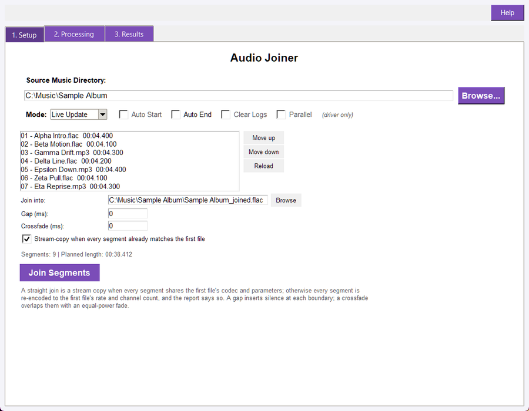
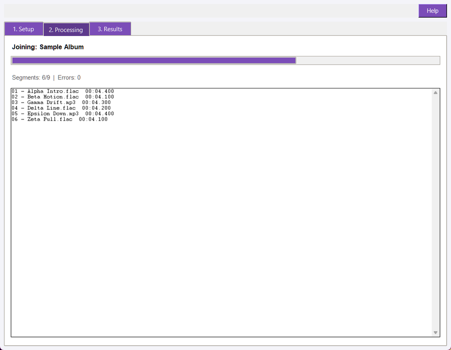
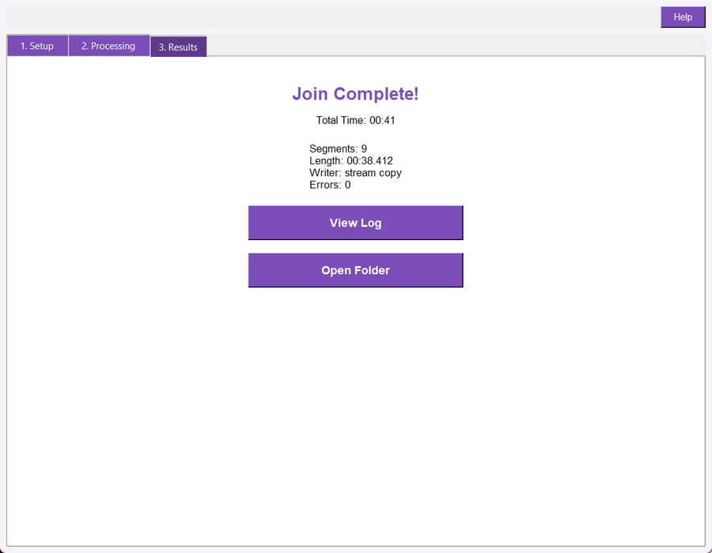

## Overview

Audio Joiner joins a folder's recordings end to end into one file. A live set
recorded to ten files, a spoken-word series, a DJ mix cut into sides: anything
whose parts belong in a single file is joined in the order you choose, with an
optional silence gap or an equal-power crossfade at every boundary.

A straight join is a **stream copy** when every segment already carries the first
file's codec and parameters, so nothing is re-encoded and nothing is lost.
Segments that differ are re-encoded together to the first file's sample rate and
channel count, and the run report says so instead of quietly copying mismatched
streams. The joined file carries the first segment's tags.

The window has three tabs: Setup holds the folder, the segment order, the
boundary settings and the action; Processing shows the run's progress; and
Results appears when the run finishes, with the counters, the run report and the
output folder.

## Quick Start

1. Open Audio_Joiner.pyw.
1. On the Setup tab, select the folder holding the segments, or use the restored last folder.
1. Check the segment list: it lists the folder's audio files in join order. Use Move up and Move down to reorder, and Reload after adding files.
1. Leave Gap and Crossfade at 0 for a straight join, or set one of them. They describe the same boundary two ways, so a run uses one or the other.
1. Name the output file in Join into, or leave it empty to write the first segment's name with `_joined` beside the originals.
1. Click **Join Segments**.
1. View the Results tab for the segment count, the joined length and the writer (stream copy or re-encode), then open the folder to check the file.

A Dry Run on the same folder reports the plan and writes nothing, so it is the
way to check the order and the settings before a long join.

## Setup Tab



- **Source folder:** The folder holding the segments. It is read for the supported audio extensions, and the list shows each file with its measured length.
- **Segment list:** The join order, top to bottom. Move up and Move down reorder the selected entry; Reload re-reads the folder and keeps the order you chose.
- **Join into:** The file the join is written to. Empty writes the first segment's stem with `_joined` beside it, so no segment is ever replaced. A name the filesystem accepts is used as typed, including commas, apostrophes and brackets; only characters no filesystem can hold are refused, with the offending name in the message.
- **Gap (ms):** Silence inserted at every boundary.
- **Crossfade (ms):** Equal-power overlap at every boundary. The outgoing tail and the incoming head are faded by a cosine and a sine over the same quarter turn, so correlated audio keeps its level instead of dipping.
- **Stream-copy when every segment already matches:** On by default. It lets a straight join run without re-encoding; turning it off re-encodes anyway.
- **Dry Run / Live:** Live writes the joined file; Dry Run plans it and writes nothing.

## Processing Tab



The Processing tab reports the run as it happens: a progress bar over the
segments, a `Segments: done/total | Errors: n` counter, and one line per
segment read, naming the file and its measured length. A long join therefore
shows that it is working through the order, and where in the order it is.

## Results Tab



The Results tab shows the completion heading, the total time, and the summary:

- **Segments:** how many files were joined.
- **Length:** the planned length of the joined file, in `MM:SS.mmm`.
- **Writer:** stream copy or re-encode.
- **Errors:** how many segments could not be read.

View Log opens this run's report, and Open Folder opens the folder the join was
written to.

## The Run Report

Every run writes its report beside the segments it joined:

- `audio_joiner_sync_log.txt` for a live run.
- `audio_joiner_dry_run_log.txt` for a dry run.

The report opens with `AUDIO JOINER REPORT` and the mode, then the folder, the
output file, the segment count, the gap and crossfade settings and the
compatibility decision, one line per segment with its measured length, and a
`SUMMARY:` block with the planned length, how many files were written, the
writer, whether the tags were copied, the error count and the elapsed time. A
dry run and a live run write different files, so the report you open is always
the run you started.

## Segment Order

The order is the join order, and it is the one thing a joiner must get right.
The list is filled from the folder sorted by name, because that is the order a
split recorded to numbered files leaves behind. A file name that itself
contains a comma is no problem: the order is matched against the folder's own
files, so `1-03 Johnny, Don't Do It.mp3` is one entry, not two. Any order you set is kept when
you reload, and a run names the order it used in its report, so a joined file
can be re-created exactly.

A folder with fewer than two supported files cannot be joined, and the window
says so instead of writing a copy of one file.

## Boundary Settings

Two settings describe what happens where one segment meets the next, and a run
sets at most one of them.

- **Gap:** Inserts silence between the segments, so the joined file is longer than its parts by that amount at every boundary. Use it for a spoken-word series or anything that should not run together.
- **Crossfade:** Overlaps the end of one segment with the start of the next, so the joined file is shorter by that amount at every boundary. Use it for a continuous mix. The overlap must be shorter than the shortest segment; a longer one would consume a whole segment, so the tool refuses it and names the reason.
- **Neither:** A hard join at the sample where one segment ends and the next begins. Nothing is added and nothing is removed.

The planned length is always `sum + gaps - overlaps`, and the window shows it
under the list before you run, so the count can be checked against the file that
comes out.

## Compatibility and Re-encoding

The extension does not say whether two files can be copied together: two MP3s at
different sample rates are both `.mp3`. Audio Joiner probes every segment and
compares its codec, sample rate, channel count and container with the first
file's.

- **All identical:** a straight join (no gap, no crossfade, same output extension) is written by copying the streams, so no generation of lossy re-encoding is added.
- **Any difference:** every segment is re-encoded to the first file's sample rate and channel count, and the report names the first segment that differed and what it carried. Nothing is copied into a mismatched stream.

A lossless source keeps its bit depth: a 24-bit FLAC joins to a 24-bit FLAC.

## Tags

The joined file takes the first segment's tags: title, artist, album, album
artist, date, genre, track and disc numbers, and comment. That is the one policy
that never invents a value: the join is the first segment's recording extended
by the rest. WAV and AIFF carry no writable tag block, so the report says the
tags were not written rather than claiming they were.

## Command Line

```text
python -m audio_suite_shared.cli_app join "D:\Music\Live Set" --order "01 intro.flac,02 theme.flac,03 outro.flac"
python -m audio_suite_shared.cli_app join "D:\Music\Live Set" --crossfade-ms 1500 --output "D:\Music\set.flac"
python -m audio_suite_shared.cli_app join "D:\Music\Live Set" --gap-ms 800 --dry
python -m audio_suite_shared.cli_app join "D:\Music\Live Set" --json
```

`--order` names the files inside the folder, in join order; leave it out to join
every supported file in name order. `--output` names the joined file, `--gap-ms`
inserts silence, `--crossfade-ms` overlaps, `--no-copy` forces a re-encode and
`--dry` writes nothing. The command exits 0 for a clean run, 1 when the join
failed, and 2 for a usage error.

## Troubleshooting

- **The segment list is empty:** the folder holds no supported audio files, or it is the wrong folder. Pick the folder that contains the segments and press Reload.
- **A join needs at least two files:** the folder has one supported file; add the rest or name them with --order.
- **The crossfade is refused:** it is not shorter than the shortest segment. Lower it, or use a gap instead.
- **Gap and crossfade together are refused:** they describe the same boundary two ways. Set one.
- **The result sounds like a different recording:** the segments were re-encoded because their streams differ. Open the report: it names the first segment that differed and what it carried.
- **The tags are missing:** the output is a WAV or AIFF, which carries no writable tag block, or the first segment had none to copy. The report states which case applied.
