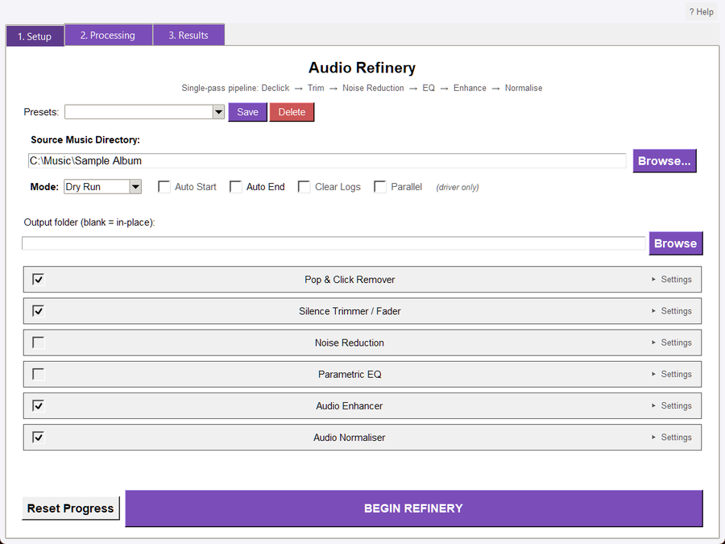
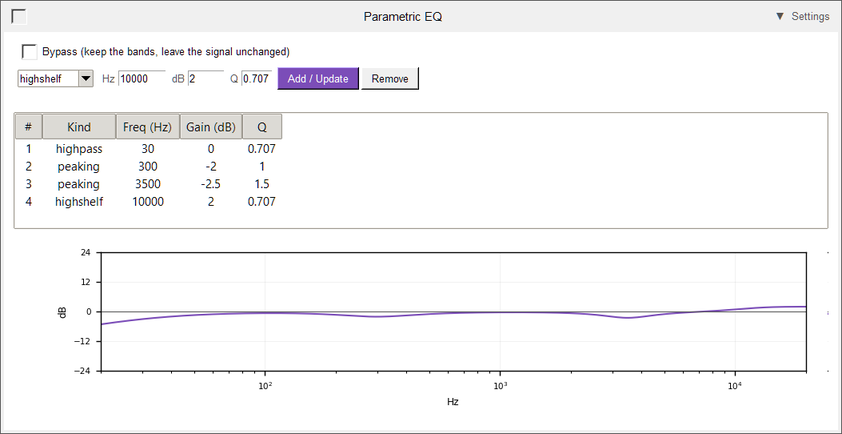
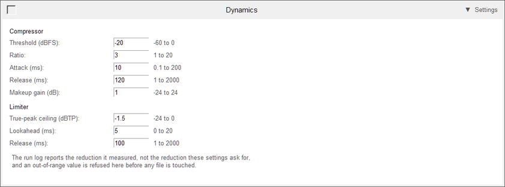
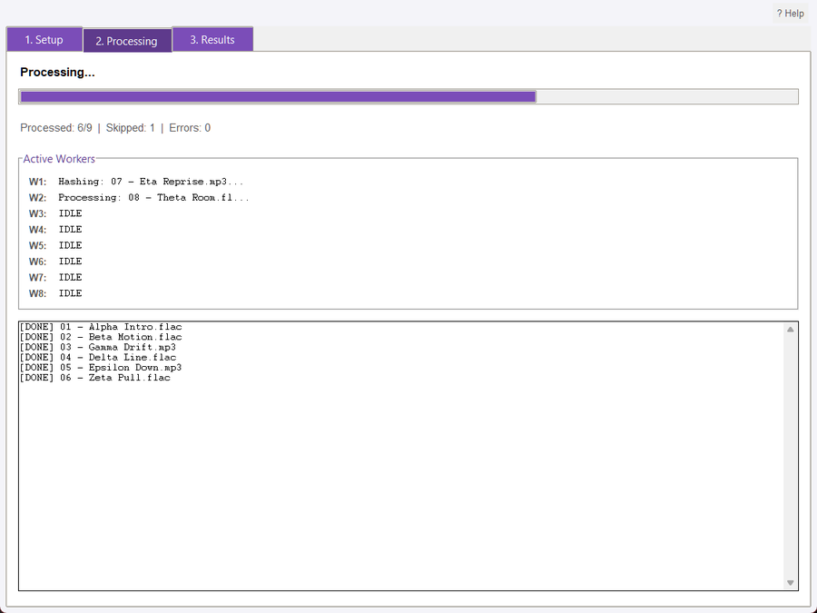
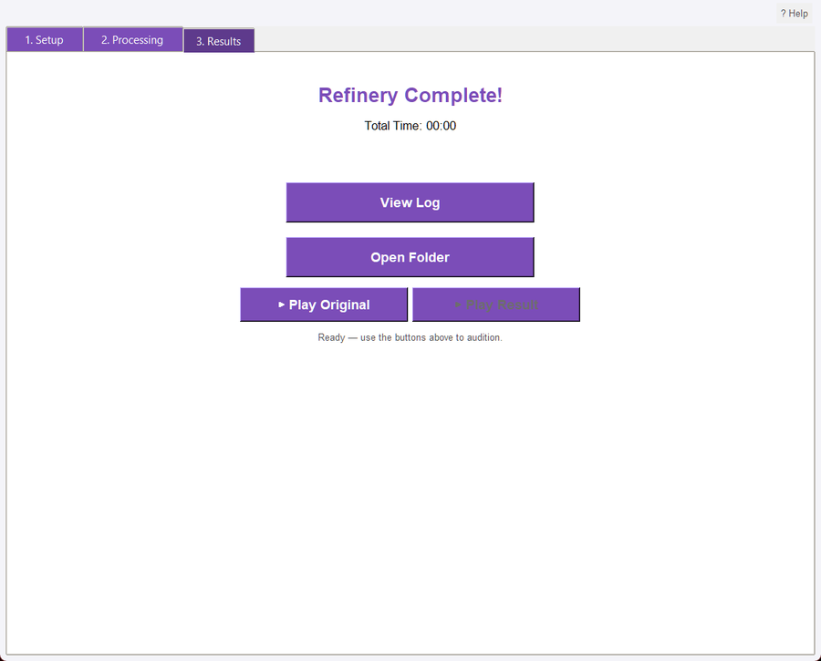

## Overview

Audio Refinery is a single-pass audio processing pipeline. It loads each source file once, runs the selected stages in memory, exports the result, restores the original tags, and optionally applies loudness normalization. The final file is placed in a separate output folder or atomically replaces the source when running in place.

The window has three tabs in the order a run happens: **1. Setup**, **2. Processing**, **3. Results**. Inside Setup the controls read top to bottom: Presets, the run controls, the output folder, then the seven stage panels in the order the pipeline runs them - Pop & Click Remover, Silence Trimmer / Fader, Noise Reduction, Parametric EQ, Dynamics, Audio Enhancer, Audio Normaliser - and finally Reset Progress and BEGIN REFINERY. The subtitle under the window title names that same order: **Declick -> Trim -> Noise Reduction -> EQ -> Dynamics -> Enhance -> Normalise**. This guide follows the window in that order.

The pipeline is designed to combine several suite tools without repeatedly decoding and encoding the same file. It validates file integrity before expensive DSP work, sizes its worker slots from the CPU count (at most eight), retries transient failures, and records completed files in a hash-based registry.

## Supported Audio

The refinery discovers the shared Audio Suite audio extensions, including MP3, FLAC, OGG, M4A, Opus, and WAV. The pipeline uses pydub/FFmpeg-backed decoding and format-aware export. Files must pass existence, readability, size, container-header, decode, sample-rate, duration, and channel checks before processing.

## System Requirements

This tool requires ffmpeg and ffprobe to be installed and on PATH. ffmpeg decodes and encodes the audio formats the suite reads and writes; ffprobe reads stream metadata (duration, codec, bitrate) for analysis tools. The suite shows a startup warning naming any missing binary and how to install it.

- Windows: winget install Gyan.FFmpeg
- macOS:   brew install ffmpeg
- Linux:   sudo apt install ffmpeg

## Quick Start

1. Open Audio_Refinery.pyw.
1. On the Setup tab, select a source folder containing supported audio files.
1. Optionally choose an output folder; leave it blank for in-place replacement.
1. Pick a saved Preset, or start from the stage selection the window opens with: Pop & Click Remover, Silence Trimmer / Fader, Audio Enhancer and Audio Normaliser are enabled, while Noise Reduction, Parametric EQ and Dynamics are off until you tick them.
1. Open each stage's Settings to adjust it: add Parametric EQ bands to shape the tone, or set the compressor and limiter under Dynamics.
1. Leave Mode set to Dry Run for the first pass.
1. Click BEGIN REFINERY.
1. Follow the run on the Processing tab, then review the Results tab's counters, refinery_log.txt and audition controls.
1. Switch Mode to Live Update only after confirming the intended stages and output.

## The Setup Tab



The Setup tab holds everything a run needs, in the order you work through it.

### Presets

The Presets row saves, loads, and deletes the complete stage configuration, including stage toggles and stage parameters. Loading a preset restores the stage panels you see - including the Parametric EQ band table and its curve - so the window always shows the settings the next run will use.

### Run Controls

- **Source Music Directory: **Required directory containing supported audio files. The application validates the directory and checks for audio before starting.
- **Mode: **Dry Run (the default) or Live Update. Dry Run validates and decodes each file and runs the enabled stages' detection without writing anything; Live Update runs the selected stages and writes the results.
- **Auto Start, Auto End, Clear Logs, Parallel: **These mirror the Master Driver's control strip and are marked "(driver only)". Run the tool standalone and Auto Start, Clear Logs and Parallel are greyed out, while Auto End is editable but has nothing to end. They take effect only when the Master Driver launches the Refinery.

### Output Folder

Optional. Blank means in-place replacement; a selected existing directory receives results with the source filenames. The directory must already exist.

### Stage Controls

The seven collapsible stage panels sit below the paths, in the order the pipeline applies them. Each panel has a checkbox that enables the stage for the run, and a **Settings** expander that reveals that stage's controls. Tick a stage and open its Settings to change anything; the values you see are the values the run uses.

At least one stage must be enabled. The window opens with Pop & Click Remover, Silence Trimmer / Fader, Audio Enhancer and Audio Normaliser enabled, and Noise Reduction, Dynamics and Parametric EQ disabled; enable an optional stage when a file needs it. SELECT ALL follows whichever stages have a panel, so it covers every one of them.

#### Pop & Click Remover

- **Click sensitivity: **Default 0.31; controls click detection. Lower values are more aggressive according to the stage model.
- **Maximum defect width: **Default 2 ms; limits the click width repaired.

#### Silence Trimmer / Fader

- **Trim threshold: **Default -50 dBFS; defines silence for trimming.
- **Fades: **Optional fade-in default 500 ms and fade-out default 1000 ms after trimming.
- **Trim by: **Silence (the default) trims detected leading and trailing silence. Exact range keeps the millisecond span you enter instead: set Start (default 0) plus either End or Duration, never both. The range is checked against each file's own length before anything is written, so a range past the end of a file fails that file with both lengths in the message.
- **Exact trim accuracy: **Without Stream copy the range is cut from the decoded audio, so it is sample-accurate to the millisecond, and the file is written once through the normal export path with its bit depth preserved. With Stream copy on, the source's own frames are copied, so nothing is re-encoded but the cut lands on the container's frame boundary: an MP3 frame is about 26 ms, and the run log reports the length the copy actually produced and how far it moved. Stream copy cannot run beside the Declick, Noise Reduction, EQ, Enhance or Normalise stage, because those need the decoded audio; the run refuses that combination before touching a file rather than quietly re-encoding and calling it a copy. It supports MP3, FLAC, M4A/MP4, OGG and Opus; other containers are refused with a message that names the container.

#### Noise Reduction

Off until you tick the stage. Two independent halves:

- **Enable Hum Removal: **removes mains hum at **50 Hz** or **60 Hz**, with **Harmonics (1-20)** default 8 and **Q Factor (1-100)** default 30.
- **Enable Broadband Noise Reduction: **uses a noise profile taken from **Noise Start (ms)** to **Noise End (ms)** - defaults 0 to 500 ms - and a **Gate Threshold (dB)** default 3.

#### Parametric EQ

Off until you tick the stage. Parametric EQ shapes tone with up to eight bands. It runs after Noise Reduction and before Dynamics, so it changes what the compressor hears: a boost you add here can push those frequencies over the threshold, and the compressor then turns part of it back down. Decide the tone first, then set the compressor against the shaped signal.

**The five band kinds**

| Kind | What it shapes | Gain | Q |
|---|---|---|---|
| peaking | a bell around the centre frequency: lift or cut one region and leave its neighbours alone | +/-24 dB | 0.1-18 |
| lowshelf | everything below the corner, fading in through the corner | +/-24 dB | 0.1-18 |
| highshelf | everything above the corner, fading in through the corner | +/-24 dB | 0.1-18 |
| highpass | removes what is below the corner and passes the rest | not used | fixed |
| lowpass | removes what is above the corner and passes the rest | not used | fixed |

**What frequency, gain and Q do**

- **Hz** is where the band acts: the centre of a bell, the corner of a shelf, or the point a high-pass or low-pass filter has already fallen 3 dB.
- **dB** is how far the band moves the level: negative cuts, positive boosts. It is the gain at the centre or in the shelf's flat part, not the gain everywhere.
- **Q** is how narrow the band is. It matters most on a peaking band, where a low Q spreads the change over whole octaves and a high Q confines it to a narrow slice. The table below measures a +6 dB bell at 1 kHz, one octave either side of its centre.

| Q | Gain an octave away (500 Hz and 2 kHz) |
|---|---|
| 0.5 | +3.8 dB |
| 0.7 | +2.9 dB |
| 1.0 | +1.9 dB |
| 2.0 | +0.6 dB |
| 4.0 | +0.2 dB |
| 8.0 | below +0.1 dB |

A practical reading of that: Q 0.3-0.7 shapes a whole region (the low end, overall brightness), Q 0.7-1.5 is a musical cut or lift, Q 2-4 targets a problem area such as a resonant note or a boxy cabinet, and Q 6-18 is surgical and best used to cut, because a narrow, high-gain boost rings.

Q on a shelf is not "width" in the way it is on a bell. At the default 0.707 the shelf is smooth. Raising it makes the shelf resonant: a 100 Hz lowshelf with +6 dB and Q 0.707 measures +5.6 dB at 50 Hz, +3.0 dB at the 100 Hz corner and +0.4 dB at 200 Hz, while the same shelf at Q 1.5 measures +7.2 dB at 50 Hz and -1.2 dB at 200 Hz. Leave shelves at 0.707 unless that resonant lift is what you want.

High-pass and low-pass are first-order filters, so their gain and Q boxes are disabled while one is selected: a control that cannot apply is not offered. Their slope is gentle - a 40 Hz high-pass measures -7.0 dB at 20 Hz, -3.0 dB at 40 Hz and -1.0 dB at 80 Hz, which is 6 dB per octave. Two identical high-pass bands stack to 12 dB per octave (the same 40 Hz pair measures -14.0 dB at 20 Hz and -6.0 dB at 40 Hz), which is useful when one band does not remove enough rumble.

**Adding, editing and removing a band**

Tick **Parametric EQ** and open its **Settings**:



- **Kind, Hz, dB and Q:** type the values and press **Add / Update**.
- **Editing a band:** selecting a row loads it back into those fields, so Add / Update replaces that band rather than adding a second copy of it, and **Remove** deletes the selected one.
- **The curve:** drawn under the table from the same filters the run applies, by measuring their impulse response, so it shows the shape the file will have. The panel writes each edit straight into the run's configuration, which is why the curve and the audio cannot disagree.
- **Bypass:** keeps the bands in the panel and in a saved preset while leaving the signal untouched, and an empty rack does the same.

**Reading the curve**

The horizontal axis is frequency, 20 Hz to 20 kHz on a logarithmic scale; the vertical axis is dB, -24 to +24. A flat line on 0 dB is a rack that changes nothing. Because the curve is the sum of every band, overlapping bands add up: two +3 dB bells at the same frequency make +6 dB. Use it to check what a shelf really does at the edges of the spectrum, and to see a boost that is wider than you intended before you run the file.

**Starting points for common jobs**

| Aim | Band |
|---|---|
| Remove rumble and keep the low end | highpass, 30-40 Hz |
| Less mud in the lower middle | peaking, 250-400 Hz, -1.5 to -3 dB, Q 0.8-1.2 |
| Tame a harsh or sibilant top | peaking, 3-6 kHz, -1.5 to -3 dB, Q 1.5-3.0 |
| Add air without adding hiss | highshelf, 10-12 kHz, +1.5 to +2.5 dB, Q 0.707 |
| More weight in a thin recording | lowshelf, 80-120 Hz, +1.5 to +3 dB, Q 0.707 |
| A deliberate lo-fi or telephone sound | highpass at 300 Hz and lowpass at 3.4 kHz |

For an over-bright 1980s CD rip, one workable rack is a highpass at 30 Hz, a peaking cut of 2 dB at 300 Hz (Q 1.0), a peaking cut of 2.5 dB at 3.5 kHz (Q 1.5) and a highshelf lift of 2 dB at 10 kHz (Q 0.707). The same rack on the command line:

```
python -m audio_suite_shared.cli_app refine <folder> --eq-band "highpass,30" --eq-band "peaking,300,-2,1.0" --eq-band "peaking,3500,-2.5,1.5" --eq-band "highshelf,10000,2,0.707"
```

Start with cuts: a cut buys headroom for the compressor that follows, while a broad boost spends it.

**Limits, refusals and storage**

A band outside 20 Hz to 20 kHz, a gain past +/-24 dB, a Q outside 0.1 to 18, or a high-pass/low-pass band carrying a gain or a non-default Q is reported in the panel and never enters the rack, and a band at or above the file's Nyquist frequency is refused by the run rather than moved. A rack holds at most eight bands. A preset stores the stage's toggle and every band, and loading one restores the table and the curve. The stage cannot run beside Stream copy, which writes the source's own frames without decoding them.

#### Dynamics

Off by default. Tick the stage and open its Settings to set the compressor and limiter, or enable it from the command line (--stages dynamics, or any dynamics flag), a saved preset, or a Master Driver launch. It is a compressor followed by a true-peak limiter, and the run reports what it measured rather than what you asked for. Dynamics does not set the final loudness: the Audio Normaliser does that later when it is enabled.



**The compressor**

| Control | Default | What it does |
|---|---|---|
| Threshold | -18 dBFS | the level where reduction starts; quieter material is left alone |
| Ratio | 4.0 | how much the level above the threshold is reduced, as X:1 |
| Attack | 10 ms | how quickly reduction reaches full strength after the signal crosses the threshold |
| Release | 100 ms | how quickly it backs off again once the signal falls back |
| Makeup | 0 dB | a static gain added after compression; it is not counted as reduction |

How much comes off is predictable from the threshold and ratio. A steady tone 12 dB above the threshold is reduced by about 9 dB at 4:1 and 6 dB at 2:1 on paper; the installed compressor has a fixed soft knee, so it eases in early and measures a little less. Measured on tones:

| Tone level | Threshold | Ratio | Measured reduction |
|---|---|---|---|
| -6 dBFS | -18 dBFS | 2:1 | 5.4 dB |
| -6 dBFS | -18 dBFS | 4:1 | 8.1 dB |
| -12 dBFS | -18 dBFS | 2:1 | 2.4 dB |
| -12 dBFS | -18 dBFS | 4:1 | 3.6 dB |
| -18 dBFS | -18 dBFS | either | 0.0 dB |

A ratio of 1.0 measures no reduction at all, even with the tone 34 dB above the threshold, so 1.0 is the way to run the limiter on its own.

- **Threshold** is the control to reach for first. Lower it and more of the file is compressed; raise it towards the loud moments and only peaks are caught.
- **Ratio** decides character. 1.5-2.5 glues a performance without flattening it, 3-4 controls a mix that jumps around, and above 6 the effect is obvious and best used on a problem rather than a whole track.
- **Attack** decides what happens to the first moments of a hit. 1-10 ms holds transients down and can soften drums; 20-40 ms lets the attack through and then controls the body, which usually keeps more punch.
- **Release** decides how the level recovers. Under about 30 ms the level can pump on bass notes; 50-150 ms suits most music; very long releases keep the gain down between phrases and can make a track feel quieter over time.
- **Makeup** restores the level compression removed. Because the report measures the output, raising makeup shows up as a higher output LUFS, not as less reduction.

**The limiter**

| Control | Default | What it does |
|---|---|---|
| Ceiling | -1.0 dBTP | the true-peak level the limiter will not let the signal pass |
| Lookahead | 5 ms | how far ahead it looks for a peak, so it can turn the gain down before the peak arrives |
| Release | 100 ms | how quickly it recovers after a peak |

The limiter uses oversampled true-peak detection, so it holds inter-sample peaks that a sample-peak meter would miss, and -1.0 dBTP leaves a little room for the lossy encoders MP3 and OGG use. It only acts on what crosses the ceiling: a 0 dBFS sine through a -1.0 dBTP ceiling measures 1.0 dB of reduction and comes out at -1.0 dBTP, while a quiet track passes through untouched. Shorter lookahead catches faster peaks but can distort them; the 5 ms default is a reasonable compromise, and longer lookahead is smoother at the cost of more internal delay.

**Reading the run log**

The stage writes one line per file:

```
[Dynamics] Max 4.3 dB reduction (mean 1.4 dB), -17.6 LUFS / -1.9 dBTP
```

- **Max** is the largest reduction in any 50 ms block: the hardest the compressor and limiter worked on that file.
- **Mean** is the average over the audible blocks (blocks below -60 dBFS are skipped, because silence says nothing about ratio).
- A high max with a low mean means occasional peaks were caught, which is what a limiter does. A mean close to the max means the compressor worked almost continuously, which is what heavy compression sounds like.
- **LUFS and dBTP** describe the rendered output, measured from the audio that would be written. They are not the requested settings, and they do not include the makeup gain in the reduction figures.
- "No reduction - signal unchanged" means nothing crossed the threshold and the file was left byte-identical.

**Starting points**

| Aim | Threshold | Ratio | Attack | Release | Makeup | Ceiling |
|---|---|---|---|---|---|---|
| Gentle glue that keeps the dynamics | -22 dBFS | 2.0 | 20 ms | 200 ms | +2 dB | -1.0 dBTP |
| Control a spiky mix | -20 dBFS | 3.0 | 10 ms | 120 ms | +1 dB | -1.5 dBTP |
| Limiter only, as a peak safety net | any | 1.0 | 10 ms | 100 ms | 0 dB | -1.0 dBTP |
| Dense, loud master | -24 dBFS | 4.0 | 5 ms | 80 ms | +3 dB | -1.0 dBTP |

These are starting points, not targets: the report tells you what the file actually needed, so adjust the threshold until the mean reduction sits where you want it (roughly 1-2 dB for glue, 2-4 dB for control) and listen to the result.

**How Dynamics fits with the other stages**

- **After Parametric EQ:** the compressor reacts to the shaped signal, so an EQ boost raises the level the compressor sees. If a bass lift disappears after compression, either cut elsewhere instead of boosting, raise the threshold, or lower the ratio.
- **Before Audio Enhancer:** the enhancement presets carry their own compressor and limiter. Running both means two stages of gain reduction, so either use Dynamics with a preset whose own compression is mild (Mild, or Custom with its compressor set neutral) or leave Dynamics off and let the preset do the work. The log names each stage separately, so you can see which one moved the level.
- **Before Audio Normaliser:** normalisation runs last and sets the final loudness. With the default Playlist loudness target it measures the compressed result, so a heavily compressed track needs less gain and the final file can be quieter than the Dynamics report suggests. The report's LUFS is the level before normalisation.
- **Peaks and the ceiling:** the limiter's ceiling applies at this point in the chain. When the Audio Normaliser runs afterwards with the Playlist loudness target it enforces its own True peak target, so the final peak is that target; if the ceiling must be the last word, use the Peak target and set its True peak to the ceiling you want, or turn normalisation off.
- **Dry Run:** the compressor and limiter really run on the decoded audio and are really measured, so a Dry Run's reduction and level figures are the ones a live run would write. Nothing is written during the Dry Run.
- **Stream copy:** the stage cannot run beside Stream copy, which writes the source's own frames without decoding them.

**What Dynamics cannot do**

It can only reduce what is there. A master that was already compressed hard has no dynamics left for this stage to preserve, and no setting restores them: that needs the original recording. Use Dynamics to shape an uncompressed or lightly processed track, or to hold a ceiling, rather than to repair a squashed one.

#### Audio Enhancer

- **Preset: **Mild, Moderate, Aggressive, or Custom. Selecting Custom shows a Configure Custom DSP button that opens the stage's own non-modal editor, so the stage itself stays compact and every control is reachable; changes apply to the run as you make them. When Audio Normaliser is active, the refinery suppresses enhancement output gain so final loudness is controlled by the normalizer, and the Output Gain control is hidden because it has no effect.
- **Enhancement effects: **Relevant to the Custom preset: Reverse audio, Karaoke (centre-vocal removal with a 0.0-1.0 strength), Phaser, Flanger, and Chorus. Each is off by default, and the built-in Mild, Moderate, and Aggressive presets leave them off.

#### Audio Normaliser

- **Target: **Playlist loudness (the default) targets integrated loudness in LUFS. Peak targets the file's true peak in dBTP instead, with one static gain, so the track keeps its own dynamics and only its level moves. Peak mode and Album loudness cannot be combined: choosing one clears the other, and the command line refuses the pair.
- **Target LUFS: **Permitted targets are -12, -14, -16, -18, and -23 LUFS; default -14.0.
- **Tolerance: **Default 0.5 LUFS; used by the normalization stage to avoid unnecessary adjustment when loudness is already close to target.
- **True peak target: **Default -1.0 dBTP; used by the Peak target. A gain that would push the sample peak past full scale is held by the limiter instead of being clamped, and the stage reports the sample peak and the true peak it measured after the write. A file already within the tolerance is left byte-identical.
- **Strategy: **Normalise (the default) re-encodes through FFmpeg loudnorm. Lossless rewrites an MP3's global gain and re-encodes nothing; other formats fall back to the loudnorm re-encode.
- **Album loudness: **Off by default. When on, the folder is measured once as one album, and every track moves by that single gain, so the album's relative levels survive instead of each track being pushed to the target. A track whose peak plus that gain would exceed the True Peak ceiling is limited on its own: only that track's gain is reduced, and the run log names it. An album already within tolerance plans no gain at all and every file is left byte-identical. A Dry Run reports the planned gain per file and writes nothing. Album mode writes through the same encoders as per-file normalisation (MP3, FLAC, OGG, M4A, Opus, WavPack, Speex, WAV and AIFF), so a container with no normalise encoder is refused with the same message a per-file run gives. A lossless WAV or AIFF source keeps its own bit depth, so a 24-bit master is not reduced to 16 bits by the rewrite. Tracks already recorded in the completion registry are not rewritten, so their level will not match a freshly normalised album: use Reset Progress for a whole-album run.

### Reset Progress and BEGIN REFINERY

- **Reset Progress: **Clears the source folder's completion registry so every file can be processed again.
- **BEGIN REFINERY: **Starts the run with the stage selection and settings currently shown.

## How the Stages Work Together

The Refinery decodes each file once, runs the enabled stages in a fixed order on the samples in memory, and writes once. The order is not a preference you can rearrange: each stage receives what the previous stage produced, and that is what makes some combinations work and others cancel out.

1. **Integrity and load:** the file is checked and decoded, and its tags are read.
1. **Pop & Click Remover:** repairs defects on the recording before anything shapes or compresses them. A click that reaches the EQ is shaped into something else, and one that reaches the compressor triggers gain reduction on the samples after it.
1. **Silence Trimmer / Fader:** fixes the time range everything else works on, so a fade or an exact range is not measured against audio that is about to be removed.
1. **Noise Reduction:** removes hum and broadband noise before the tone and dynamics stages, so those stages shape music rather than shaping and then lifting noise.
1. **Parametric EQ:** shapes the spectrum immediately before Dynamics, so the compressor reacts to the tone you actually want.
1. **Dynamics:** compresses and limits the shaped signal, before the enhancement preset's own chain.
1. **Audio Enhancer:** applies its preset, which can include its own compression, shelves and effects, to the controlled signal.
1. **Audio Normaliser:** measures the finished audio and sets its loudness last, because every earlier stage changes the level.
1. **Export and finish:** one encode, tag restore, undo snapshot, atomic replace.

**Where EQ and Dynamics sit, and why it matters**

- **EQ before Dynamics.** The compressor reacts to level, and every EQ move changes level in its own part of the spectrum. Boosting 100 Hz by 6 dB makes the bass cross the threshold sooner, so the compressor reduces exactly the boost you just added; the track can end up no fuller, only more compressed. Cut instead of boosting where you can, and set the threshold after the EQ is settled. The reverse problem is also real: a cut reduces what the compressor sees, so it may then do less than you expected.
- **Noise Reduction before both.** Hum and hiss are level too. Shaped by EQ and lifted by makeup gain, they become more audible than they were, which is why the cleaning stage comes first.
- **Dynamics before Audio Enhancer.** The enhancement presets carry their own compressor and limiter. Running Dynamics and then an Aggressive preset is two stages of gain reduction in a row; the log names both, and the second works on an already compressed signal. Mild, or a Custom preset with its own compressor set neutral, keeps the two from fighting.
- **Normalise last.** It is the only stage that knows the final loudness. A compressed track needs less gain to reach the same target, and with the default Playlist loudness target the normaliser applies its own True peak target, so it can move the peak that the Dynamics limiter just set. Use the Peak target when a specific ceiling must survive.
- **One decode, one encode.** Every combination above still costs a single encode. Enabling two more stages changes what the encode contains, not how many times the file is written.

**An end-to-end example: an over-bright 1980s CD rip**

The track is harsh around 3 kHz, has rumble below 30 Hz, and jumps in level compared with the rest of the album:

- **Pop & Click Remover:** on, defaults.
- **Silence Trimmer / Fader:** on, threshold -50 dBFS, no fades for a track that starts immediately.
- **Noise Reduction:** off, because no hum is audible.
- **Parametric EQ:** on, with highpass 30 Hz, peaking 300 Hz -2 dB (Q 1.0), peaking 3.5 kHz -2.5 dB (Q 1.5) and highshelf 10 kHz +2 dB (Q 0.707).
- **Dynamics:** on, threshold -20 dBFS, ratio 3.0, attack 10 ms, release 120 ms, makeup +1 dB, ceiling -1.5 dBTP.
- **Audio Enhancer:** Mild, or off: the Dynamics stage already controls the level, and a second compressor would flatten the result.
- **Audio Normaliser:** on, Playlist loudness, -14 LUFS, True peak -1.0 dBTP.

A Dry Run runs every enabled stage on the decoded audio and reports what each one found, without writing. A live run writes the same information into its log as it goes. Here is the complete report of that chain, run on the suite's own 20-second mono reference track rather than an album, so the figures belong to that file - your own track's will differ:

```
Audio Refinery - Processing Log
==================================================
[DONE] blues_shuffle_152.ogg
    [DryRun] Loaded OK (RMS: -15.1 dBFS, 20000ms, 1ch)
    [Declick] No clicks found - audio already clean
    [Trim] No silence detected - original length maintained
    [EQ] Applied 4 band(s): highpass, peaking, peaking, highshelf
    [Dynamics] Max 8.9 dB reduction (mean 4.1 dB), -20.6 LUFS / -7.4 dBTP
    [Normalise] Would adjust loudness from -15.9 to -14.0 LUFS
==================================================
Total: 1  Processed: 1  Succeeded: 1  Skipped: 0  Errors: 0  Time: 1.0s
```

Read it in the order the stages ran: the load line records what was decoded, Declick and Trim say there was nothing for them to change, EQ names the four bands it applied, Dynamics reports what it measured, and Normalise says what it would do. Nothing in the folder changed - the Dry Run reports the plan, and the source file is still the only file there.

The EQ line names the rack in the order the bands were added, and the Dynamics line is the measured report described under Dynamics above. On this reference track the mean reduction came back at 4.1 dB, the top of the control range: the settings above are a starting point, not a setting to copy, and that figure is the signal to raise the threshold. If the mean comes back near 0.0 dB, the compressor never engaged, so either lower the threshold or leave the stage off.

## Pipeline Stages

When enabled, stages run in this implementation order:

1. Integrity validation: checks existence, readability, file size, magic bytes, decoding, sample rate, duration, and channels.
1. Load: reads original tags and decodes the source audio.
1. Pop & Click Remover: detects and repairs clicks using sensitivity and maximum defect width.
1. Silence Trimming / Fading: removes silence using a dBFS threshold and can apply fade-in and fade-out. In Exact range mode it keeps the millisecond range you enter instead of detecting silence; with Stream copy on, the range is cut with one stream copy and no re-encode.
1. Noise Reduction: optionally removes mains hum and/or broadband noise using its noise profile and gate settings.
1. Parametric EQ: applies the band rack - up to eight low-shelf, high-shelf, peaking, high-pass or low-pass bands - to shape tone before any dynamics processing. A bypassed stage, or one with no bands, leaves the signal untouched. See Parametric EQ above for the band kinds, the measured Q behaviour and starting points.
1. Dynamics: applies the compressor and holds the true-peak limiter ceiling, then reports the measured maximum and mean reduction and the output's loudness and true peak. A bypassed pair leaves the signal untouched. See Dynamics above for the controls, the report and starting points.
1. Audio Enhancement: applies the Mild, Moderate, Aggressive, or Custom DSP preset; Custom adds per-effect toggles (reverse, karaoke, phaser, flanger, chorus).
1. Export: writes the processed audio once using format-appropriate encoding settings - only when a stage changed the audio.
1. Normalise: optionally measures loudness and applies the configured target and tolerance - either the LUFS playlist target, or a true-peak target in dBTP. When no earlier stage changed the audio, FFmpeg normalises the source directly in one pass. In album mode the whole folder is measured once, before any file is processed, and every track moves by that single gain.
1. Finish: restores tags, records an undo snapshot, and atomically replaces or creates the output file. A file no stage changed is left byte-identical and reported SKIPPED.

## Dry Run and Output Safety

In Dry Run, each valid file is loaded and the enabled stages run their detection on the decoded audio without writing anything: the click, silence, noise, EQ, dynamics, and enhancement stages report what they found, and Normalise measures the source and reports the loudness it would apply. No output is written, no temp file is left behind, and no completion record is created. Results include a DryRun stage with RMS, duration, and channel information, plus one entry per stage detection.

A live run that changes nothing is reported SKIPPED and leaves the file byte-identical: no re-encode, tag rewrite, undo snapshot, or replace. A lossy source is therefore not re-encoded just because a stage was enabled. A file that does change is written to a temporary file in the output directory, tagged, and only then atomically moved into the final output path. If a stage or export fails, the temporary file is removed and the original remains intact.

## Completion Registry

The refinery stores successful completion records in _refinery_completed.log in the source folder. Each record contains a SHA-256 hash and filename. A file is skipped only when both its name and pre-processing hash match a recorded completion, so a renamed or modified file is eligible for processing again. Only a run that wrote the file records a completion: a file left unchanged or seen in a Dry Run is not recorded, so a later run with different settings still processes it. Use Reset Progress to clear all records for the selected source folder.

## The Processing Tab



Processing shows one worker slot per logical CPU (at most eight), progress, and per-file DONE, SKIP, or ERROR entries. Each completed file's entry includes stage messages and metrics. The run cannot be edited from here: the stage selection is fixed when BEGIN REFINERY is pressed.

## The Results Tab



Results reports processed, succeeded, skipped, errors, and elapsed time. It can compare the original and result audio when a suitable pair exists; Dry Run has no result audio to play. **View Log** opens the run report described below, and **Open Folder** opens the folder the run wrote to.

## Logs and Recovery

The pipeline writes refinery_log.txt in the resolved output directory. It includes per-file stage output - including the EQ stage's band message - and a final total, processed, succeeded, skipped, error, and time summary. This is the run report **View Log** opens. The diagnostic log that configure_logging writes in logs/ is separate, and is for troubleshooting rather than for reviewing a run.

Tag edits are recorded in the suite batch undo system. Keep independent backups before in-place processing even though failures are protected by temporary output and atomic replacement.

## Command Line

The registered command is refine. Examples:

python -m audio_suite_shared.cli_app refine <folder> --dry\
python -m audio_suite_shared.cli_app refine <folder> --output <output> --stages declick,trim,enhance,normalise\
python -m audio_suite_shared.cli_app refine <folder> --stages declick,enhance --preset Mild\
python -m audio_suite_shared.cli_app refine <folder> --reduce-hum --hum-frequency 60 --json\
python -m audio_suite_shared.cli_app refine <folder> --stages trim --trim-mode exact --trim-start 12000 --trim-end 30000\
python -m audio_suite_shared.cli_app refine <folder> --stages eq --eq-band "peaking,1000,2.5,1.0" --eq-band "highpass,40"
python -m audio_suite_shared.cli_app refine <folder> --stages dynamics,normalise --comp-threshold -20 --comp-ratio 4 --limiter-ceiling -1

CLI options cover output directory, dry run, stages, declick sensitivity and width, trim threshold and fades, the exact trim range (--trim-mode, --trim-start, --trim-end, --trim-duration, --trim-copy/--no-trim-copy), hum and broadband reduction, enhancement preset, the parametric EQ rack (--eq-band, one "kind,freq,gain,q" band per flag, up to eight; giving one implies the eq stage), the dynamics pair (--comp-threshold, --comp-ratio, --comp-attack, --comp-release, --comp-makeup, --limiter-ceiling, --limiter-lookahead, --limiter-release; giving any of them implies the dynamics stage), the enhancement effect flags (--reverse, --karaoke/--no-karaoke, --karaoke-strength, --phaser, --flanger, --chorus), target LUFS, tolerance, true peak, LRA, the normalise strategy (--normalise-mode), the normalise target (--target-mode lufs|peak with --target-peak in dBTP), album mode (--album-mode/--no-album-mode), and JSON output. If --output is omitted, results are written in place.

The eq stage runs after noise reduction and before dynamics and enhancement, so the preset's compressor and limiter act on the shaped, compressed signal. The dynamics stage is a compressor followed by a true-peak limiter; a bypassed pair leaves the signal untouched, and an out-of-range value is refused before any file is opened. Its band kinds are lowshelf, highshelf, peaking, highpass and lowpass; a highpass or lowpass band is first-order, so it takes no gain and no Q. A band at or above the file's Nyquist frequency is refused rather than moved, and a rack with no bands or with bypass on leaves the signal untouched.

## Master Driver Use

Audio Refinery is the Master Driver's REFINE pipeline. The driver embeds the Refinery Setup controls, passes source and output folders, and supplies inherited Auto Start, Auto End, Clear Logs, and mode values. The driver uses its own batch orchestration; the Refinery's Parallel control is not an independent pipeline switch.

## Troubleshooting

- **No audio files found: **Select a source folder containing supported files directly discoverable by the processor.
- **Integrity check failed: **The file may be empty, unreadable, malformed, undecodable, outside size/duration/sample-rate/channel limits, or have invalid container headers.
- **Files are skipped on a later run: **They match the completion registry by filename and SHA-256. Use Reset Progress when a full rerun is intended.
- **The Parametric EQ is ticked but nothing changes: **Check Bypass in the EQ panel and check that the rack holds at least one band; either one leaves the signal untouched. A band at or above the file's Nyquist frequency is refused by the stage, and the message gives the band and the limit it needed.
- **An EQ band will not enter the rack: **The panel reports the reason: the frequency must be 20 Hz to 20 kHz, the gain within +/-24 dB, the Q within 0.1 to 18, and a high-pass or low-pass band takes no gain and the default Q.
- **Dynamics reports no reduction: **Nothing crossed the threshold, or the ratio is 1.0. Lower the threshold by 3-6 dB or raise the ratio; the figures are measured, so 0.0 dB means the stage changed nothing and the file was left byte-identical.
- **The file got quieter with Dynamics on: **compression reduces level, and Makeup is the control that gives it back. If Audio Normaliser is enabled it re-levels the result afterwards, so judge the finished file rather than the Dynamics report.
- **An EQ boost stopped mattering after compression: **the compressor reacts to the shaped signal. Prefer a cut elsewhere, raise the threshold, or lower the ratio, and watch the mean reduction in the Dynamics line.
- **Peaks sit above the Dynamics ceiling in the finished file: **normalisation runs afterwards and enforces its own True peak target. Use the Peak target with the ceiling you want when the ceiling must be the final word, or turn normalisation off.
- **The Parametric EQ curve is flat although bands exist: **check Bypass. A bypassed rack keeps its bands and leaves the signal alone, and the run log says so.
- **The Normalise stage skips a container: **The stage writes MP3, FLAC, OGG, M4A, Opus, WavPack, Speex, WAV, AIFF and AIF, and keeps a lossless source's bit depth. A container with no encoder (for example MP4, WMA or AAC) is reported as a skipped file naming that reason and the formats the stage writes, the file is left untouched, and every other enabled stage still runs. Convert it to one of those formats if you want it normalised.
- **The exact trim refused the run: **Stream copy cannot share a run with a stage that decodes the audio (declick, noise reduction, eq, enhance, normalise). Turn Stream copy off to trim with a re-encode, or disable those stages. A range flag without Exact range mode is refused at the command line rather than silently ignored.
- **The stream copy is a few milliseconds longer or shorter: **That is the frame boundary, not a defect: a copy keeps whole frames, and the run log reports the measured length with the offset. Turn Stream copy off when the exact millisecond matters.
- **Output directory error: **The selected output directory must already exist and be a directory; leave it blank for in-place mode.
- **Normalization behaves unexpectedly: **Remember that the normalizer controls final level when active, and enhancement output gain is suppressed in that case.
- **A stage fails: **Review refinery_log.txt for the stage-specific error. The original source is protected if the final replacement is not reached.

## Safety Recommendations

Run Dry Run first, prefer a separate output folder while tuning stages, and listen to the original/result audition pair. Use in-place mode only with backups. Reset the completion registry when configuration changes require already completed files to be processed again.
