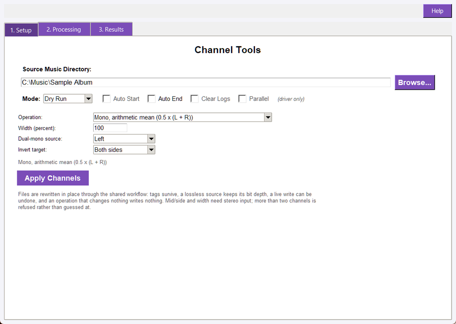
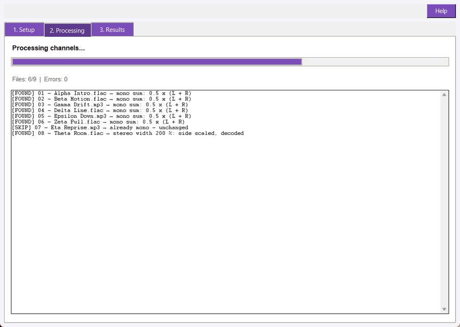
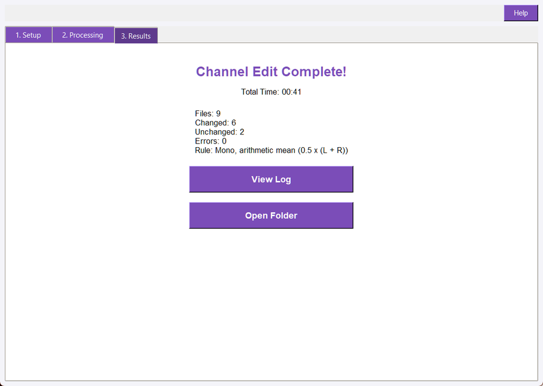

## Overview

Channel Tools applies one channel rule to every audio file in a folder, in place. It covers the jobs that sit between "the file plays" and "the file is right": collapsing a stereo mix to mono, duplicating one good channel, flipping a phase inversion, and widening or narrowing a stereo image.

The rule is applied to each file's samples and written back to the same path through the suite's shared in-place workflow, so the file's tags, sample rate and bit depth survive, a live write can be undone, and an operation that changes nothing writes nothing.

The window has three tabs: Setup holds the folder, the run mode and the operation with its parameters; Processing shows the run's progress and one status line per file; Results appears when the run finishes, with the counters, the rule that ran and the two buttons.

## Supported Audio

Channel Tools scans the shared Audio Suite supported-format list, one folder deep. The read-only extensions (`.ape`, `.mpc`, `.dsf`) are reported as skipped rather than half-written, because they cannot be rewritten in place.

A 24-bit source stays 24-bit: the in-place writer pins the source's own PCM depth instead of letting the encoder default to 16-bit.

## Quick Start

1. Open Channel_Tools.pyw.
1. On the Setup tab, select the folder to scan, or use the restored last folder.
1. Choose the operation from the list and set the parameter it reads, if it has one; the rule line under the controls says exactly what will run.
1. Leave the mode on Dry Run for the first pass.
1. Click **Apply Channels**.
1. Watch the Processing tab while the run works through the folder.
1. Read the Results tab for the counters, then open the run report with **View Log**.

A Dry Run reports every file the way a live run would and writes no audio, so it is the cheap way to check a folder before rewriting it.

## Setup Tab



- **Source Music Directory: **The folder to scan. Subfolders are not scanned. The last folder used is restored on the next launch, and **Browse...** picks a new one.
- **Mode: **Dry Run reports what would change and writes nothing; Live Update writes the audio back. The tool opens in Live Update and remembers nothing about the mode between launches.
- **Operation: **One of the seven rules listed under **The Rules**. The tool starts on the operation the last run used.
- **Width (percent): **Read by the *Stereo width* operation only. `100` leaves the image alone, `0` collapses it to mono, `200` doubles the side signal.
- **Dual-mono source: **Read by the *Dual mono* operation only: which channel is copied to both sides.
- **Invert target: **Read by the *Phase inversion* operation only: which side is negated.
- **Auto Start, Auto End, Clear Logs, Parallel: **Shown for a Master Driver launch and labelled *(driver only)*. A standalone launch leaves them unused.
- **Apply Channels: **Starts the run. It reads the folder, the operation and its parameter, then hands the batch to a worker so the window stays responsive.
- **The rule line: **Under the controls, the line restates the rule the current widgets describe, or says what is wrong with them. It is the sentence the run report and every per-file line will carry.

## The Rules

| Operation | Stored id | What it computes | Needs stereo |
|---|---|---|---|
| Mono, arithmetic mean | `mono_mean` | `0.5 x (L + R)`, the channel sum attenuated 6 dB | no |
| Mono, sum attenuated 3 dB | `mono_minus3db` | `(L + R) / sqrt(2)`, the same sum attenuated 3 dB | no |
| Dual mono | `dual_mono` | copies the named channel to both sides | no |
| Invert phase | `invert_phase` | negates the named side, or both | no |
| Mid/side encode | `ms_encode` | left = `M = 0.5 x (L + R)`, right = `S = 0.5 x (L - R)` | yes |
| Mid/side decode | `ms_decode` | left = `M + S`, right = `M - S` | yes |
| Stereo width | `width` | `M +- (width/100) x S`, i.e. scales the side signal and decodes | yes |

### The two mono rules are not interchangeable

They differ by exactly **3.01 dB**, and both are offered because either can be the right answer.

- The **mean** is the quieter of the two. A signal panned dead centre (`L = R`) sums to `2L`, and the mean returns it as `L`, the level one channel had on its own.
- The **3 dB** rule is the same sum attenuated 3 dB instead of 6 dB, so it is 3.01 dB louder than the mean for a correlated pair *and* for an uncorrelated one. Pick it when the mean leaves the result too quiet.

Both rules are measured in the suite's tests on a correlated and an uncorrelated pair, so the 3.01 dB gap is a locked property rather than a description.

### Width and clipping

Width is a percentage around unity, from **0** to **400**.

- `0` removes the side signal: both channels become the mid signal, which is mono content in a stereo file.
- `100` is unchanged. The workflow recognises that and does not rewrite the file at all.
- `200` doubles the side signal, a wider image.
- `400` is four times the side signal, the practical maximum.

Widening can push a peak past full scale. When it does, the samples are clamped to +/-1.0 and the file's line says `clamped to full scale`, so a clipped result is never silent about it. A Dry Run reports the same line.

### Mid/side pairs

Encode writes the mid signal on the left channel and the side signal on the right, so an encoded file is an ordinary stereo file whose two channels are mid and side rather than left and right. Decode turns it back. Both steps keep the file's length, rate and depth, and `decode(encode(x))` returns `x`.

### Mono, stereo and surround sources

- **A mono rule accepts either layout.** A file that is already mono is skipped as unchanged rather than rewritten.
- **Dual mono on a mono file** copies the one channel it has to both sides, which is how a mono recording becomes a true stereo file.
- **Mid/side, width and phase inversion of both sides need two channels.** A mono file is refused with `this rule needs a stereo file` instead of being guessed at.
- **More than two channels is refused.** Downmixing a 5.1 file is a mix decision, not a channel utility, so the file is reported and skipped rather than silently reduced to one pair.

## Processing Tab



The tab shows the status line, a progress bar over the files in the run, a counter and the worker grid. Every finished file adds one line in the shared in-place shape: `[FOUND] name -> rule` for a file a Dry Run would change, `[FIXED] name -> rule` for one a live run rewrote, `[SKIP] name -> reason` for one the rule left alone, and `[ERROR] name: message` for one that could not be read.

The counter reads `Files: processed/total | Errors: n`, so a long folder shows progress even while the status line is static.

## Results Tab



The completion heading is **Channel Edit Complete!**, over five lines: the files scanned, the files changed, the files left unchanged, the errors, and the rule that ran. **View Log** opens the run report, and **Open Folder** opens the folder that was scanned.

A Dry Run counts a file it *would* change as changed, so its counters read the same way as a live run's.

## Dry Run and Live Update

- **Dry Run: **decodes every file, applies the rule and reports `[FOUND]` without writing audio.
- **Live Update: **applies the rule, writes the result back and reports `[FIXED]`.
- **Unchanged files: **a file the rule leaves byte-identical is reported `[SKIP]` in both modes and its bytes are never touched.
- **Failures: **a file that cannot be decoded is reported `[ERROR]` and counted, and the run continues with the next file.

## The Run Report and the Logs

Every run writes a report beside the files it scanned:

- `channel_tools_dry_run_log.txt` for a Dry Run;
- `channel_tools_sync_log.txt` for a live run.

The report opens with `CHANNEL TOOLS REPORT`, names the mode, the folder and the operation, and draws a `=` rule. One line per file follows, in the same shape the Processing tab shows, then a `SUMMARY:` block with the files, changed, unchanged and error counts and the run time.

**View Log** opens this report, not the program's diagnostic log. That one is written under `logs/` and records the frame count, export parameters and errors for support, so the two files have different audiences.

## Undo

A live run records a byte-level snapshot of each file it rewrites in the suite's batch undo, taken while the source still holds its pre-run audio. Undo restores the original bytes, audio and tags alike. A Dry Run records nothing.

## Command Line

```text
python -m audio_suite_shared.cli_app channels "D:\Music\Sample Album" --operation mono_mean --dry
python -m audio_suite_shared.cli_app channels "D:\Music\Sample Album" --operation width --width 200
python -m audio_suite_shared.cli_app channels "D:\Music\Sample Album" --operation dual_mono --source-channel right
python -m audio_suite_shared.cli_app channels "D:\Music\Sample Album" --operation invert_phase --invert both
python -m audio_suite_shared.cli_app channels "D:\Music\Sample Album" --operation ms_encode --json
```

- `--operation` takes one of the stored ids in **The Rules**; the default is `mono_mean`.
- `--width` takes 0 to 400 and is read by `width` only.
- `--source-channel` takes `left` or `right` and is read by `dual_mono` only.
- `--invert` takes `left`, `right` or `both` and is read by `invert_phase` only.
- `--dry` / `--live` selects the mode; the default is a live run, the opposite of the window's.
- `--json` / `--text` selects the output shape. The JSON payload carries the tool and command names, the mode, `total`, `processed`, `succeeded`, `skipped`, `errors` and the per-file log lines.

Text mode prints one summary line and the rule, and the command exits 1 when any file failed and 0 otherwise.

## Master Driver Use

From the Master Driver, open the utilities list and select Channel Tools. The driver passes the folder, the run mode, the start and end flags and the operation with its parameters through `Channel_Tools.pyw`, so the child window opens on the rule the driver's card showed. A driven launch can start the run on its own, and the driver's step fails when the child reports an error.

## Troubleshooting

- **Every file was skipped as unchanged:** the chosen mono rule has nothing to do to a one-channel file, or the width is `100`. Both are skips, not errors.
- **A stereo rule refused the folder:** *Dual mono*, *phase inversion*, *mid/side* and *width* need two channels. A mono file is refused with `this rule needs a stereo file`; use a mono rule, or convert the layout first.
- **A surround file was refused:** more than two channels is refused outright, because downmixing is a mix decision. The line names the channel count it found.
- **The width field is not a number:** the rule line says so and the run will not start. Clear the field for `100`, or type a percentage from 0 to 400.
- **The widened file sounds clipped:** that is what happened. The side signal pushed peaks past full scale and they were clamped, and the file's line says `clamped to full scale`. Use a smaller width, or normalise afterwards.
- **A 24-bit file came back at a different depth:** it should not, because the writer pins the source's PCM codec. Check the file's report line and the diagnostic log under `logs/` for the export parameters.
- **The file is read-only:** `.ape`, `.mpc` and `.dsf` cannot be rewritten in place and are skipped with that reason.
- **Nothing happened when Apply Channels was clicked:** the folder is empty, missing, or holds no supported audio; the window warns about a missing folder and a run over an empty folder reports zero files.

## Safety and Recovery

In place means exactly that, so run a Dry Run first and keep backups of anything irreplaceable. A mid/side encode is a working state rather than a finished file: keep the original until the decode has written it back, because encoding twice does not return the source. Use the suite's Undo Tag Edits workflow, or the batch undo, to restore the bytes a live run rewrote.

## Related Tools

- **Audio Normalizer** adjusts loudness and peaks, for level rather than channel layout.
- **Metadata Scrubber** edits tags only, and never samples.
- **Restoration** repairs de-clipping, hum and clicks, so repair before widening an image.
