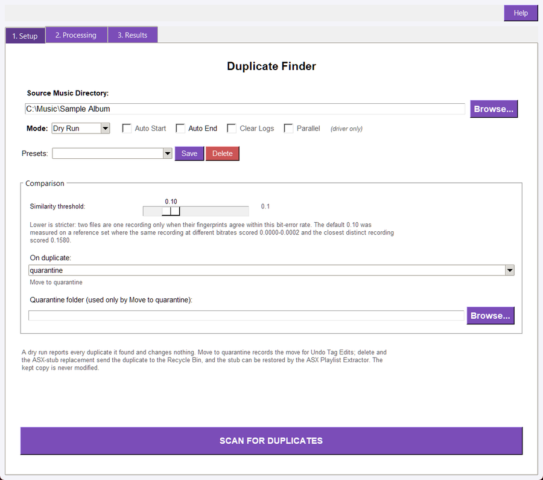
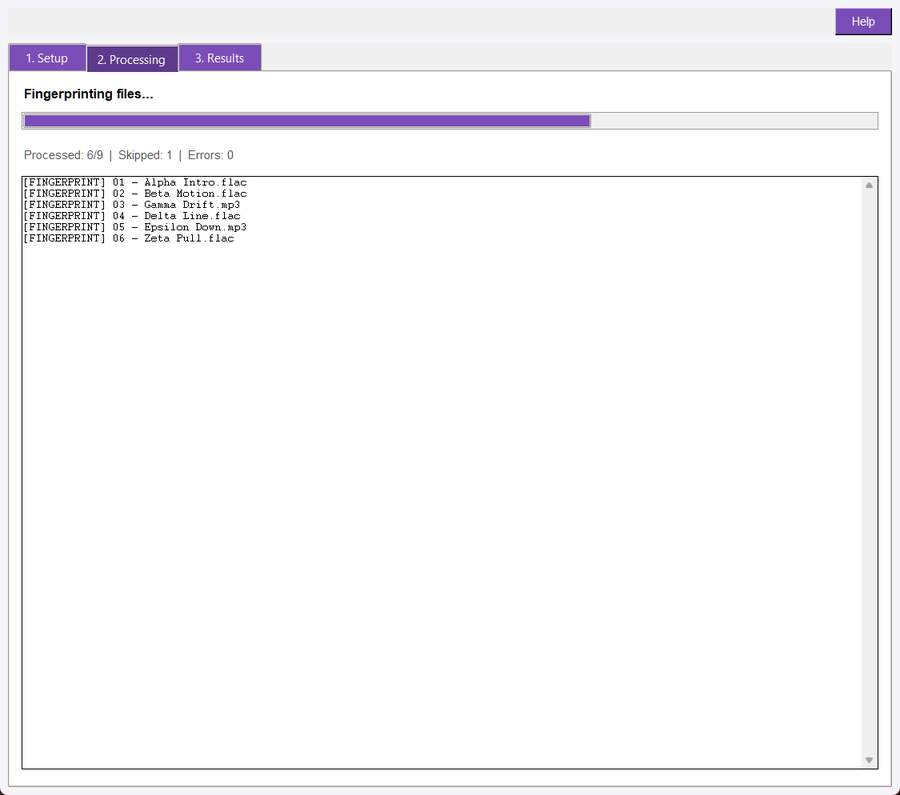
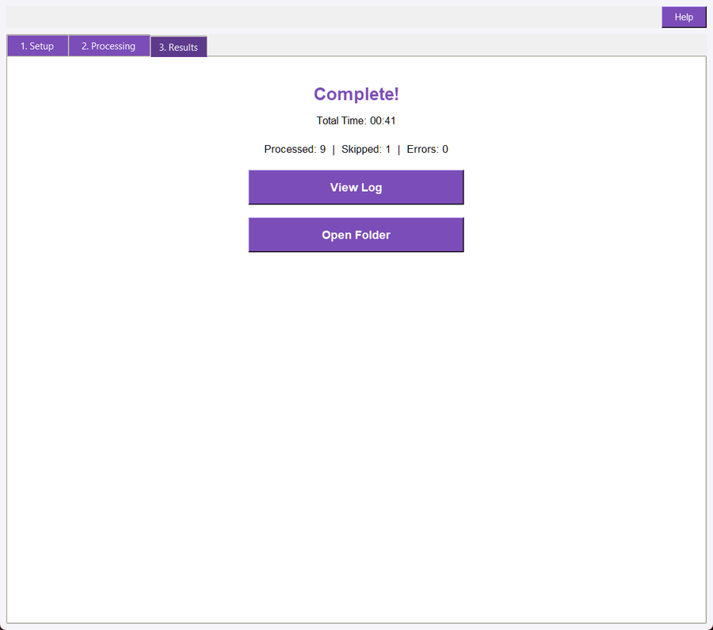

## Overview

Duplicate Finder notices when two files in a library are **the same recording** — the FLAC master and the 128 kbit/s copy you made for a phone, the album track and the version that came back from a compilation — and offers to set the extra copies aside.

It compares audio fingerprints, not file names or tags. The suite's own AcoustID client can tell you that one file **is** a particular recording; this tool answers the different question a library owner asks: **of these four hundred files, which ones are the same recording as each other?**

You choose what happens to the extra copies. **Move to quarantine** (the default) moves them into a folder and records every move in the suite's undo history, so you can put them back. **Delete** and **Replace with an ASX stub** send them to the operating system's Recycle Bin; the first such run installs the required Recycle Bin support automatically. The stub points at the kept file and can be restored later by the ASX Playlist Extractor. The kept copy is never modified.

## Supported Files

The scan walks the selected folder recursively and fingerprints every file with an extension the suite supports — MP3, FLAC, OGG, Opus, M4A, MP4, WAV and AIFF variants. An unreadable file is reported and skipped; it never stops the run.

## System Requirements

This tool needs the Chromaprint fingerprint calculator (`fpcalc`), which ships in the suite folder, and the same ffmpeg/ffprobe pair every audio tool uses. Where a binary is missing the run reports it instead of producing empty fingerprints.

## Quick Start

1. Open Duplicate_Finder.pyw.
1. Select the folder holding the library. Sub-folders are included.
1. Leave Dry Run selected and click SCAN FOR DUPLICATES.
1. Read the report in the Results tab: one **KEEP** line per recording, followed by its duplicates and each one's measured distance.
1. If the groups look right, choose Live Update and pick **On duplicate** - Move to quarantine, Delete, or Replace with an ASX stub - then run again.

## Setup

Setup opens with the shared Run Controls strip — the source folder, **Browse**, the **Mode** dropdown, the driver's Auto Start / Auto End / Clear Logs / Parallel display, and the **SCAN FOR DUPLICATES** button — followed by this tool's own **Comparison** group.

- **Similarity threshold:** the maximum bit-error rate at which two fingerprints count as one recording. Lower is stricter. The default **0.10** was measured, not guessed: on the reference set the same recording at different bitrates scored 0.0000–0.0002 and the closest pair that must stay apart scored 0.1580.
- **On duplicate:** what a live run does with each duplicate. **Move to quarantine** is the default and the only option that uses the quarantine folder. **Delete (Recycle Bin)** sends it to the Recycle Bin. **Replace with an ASX stub** writes a small playlist beside it, then sends the duplicate to the Recycle Bin; the ASX Playlist Extractor can recreate the file from that stub.
- **Quarantine folder:** where Move to quarantine sends duplicates. Leave it blank to use a `duplicate_quarantine` folder inside the scanned directory. The entry is disabled for the two Recycle Bin options.
- **Presets:** the shared preset row saves the threshold, the quarantine folder, the duplicate handling and the run mode.

## How a Scan Works

1. Every supported file under the folder is fingerprinted with `fpcalc -raw`; the fingerprint is cached so the next run does not repeat that work.
1. Two files are compared only when their durations agree closely and their fingerprints share an exact sub-fingerprint, which is what keeps a large library affordable.
1. Each candidate pair is measured with a bit-error rate after aligning the two fingerprints — an MP3 adds a few tens of milliseconds of padding, so an unaligned comparison would report two encodings of one recording as different.
1. Pairs at or below the threshold are joined, and a connected group of files becomes one recording.
1. The **keeper** is chosen from measured file properties only: lossless first, then bitrate, then sample rate, then the longer file. Tags are deliberately **not** consulted — they are exactly what is unreliable in a duplicate set.
1. A live run applies **On duplicate** to every non-keeper. Quarantine moves it into the chosen folder (adding ` (2)`, ` (3)`… rather than overwriting). Delete sends it to the Recycle Bin. ASX stub writes `<name>.asx` beside it, checks that the playlist parses and points at the keeper, and only then sends the duplicate to the Recycle Bin. The keeper is only ever read.

## Dry Run and Live Update

- **Dry Run:** fingerprints, groups and reports. Nothing is moved, no stub is written and the quarantine folder is not even created. The report says what the live run would do.
- **Live Update:** applies the chosen handling. Quarantine records every move in the suite's undo history; Delete and ASX stub use the Recycle Bin and are not added to that journal, so recovery is the Recycle Bin (or the ASX Playlist Extractor for a stub). An interactive run asks once before it removes anything. The kept copy is left byte-identical.
- **Report:** each run writes `duplicate_finder_dry_run_log.txt` (or `duplicate_finder_sync_log.txt` for a live run) into the folder it scanned. The Results tab's **View Log** opens it.

## The Fingerprint Cache

Fingerprinting is the slow part of a scan, so each file's fingerprint is stored and reused. A stored fingerprint is trusted only while the file's modification time **and** size are unchanged — a file replaced by a copy that preserved its timestamps is fingerprinted again. The cache lives in one place, `~/.audiosuite/duplicate_cache.db`, never inside the music folder.

## Processing and Results

Processing shows one worker slot per logical CPU (at most eight), a progress bar, the shared processed / skipped / error count and one line per file: `[FINGERPRINT]` or `[CACHED]` while scanning, `[SKIP]` for a file without a readable fingerprint.

Results shows the completion summary with the group count, the duplicate count, how many files were quarantined, deleted or stubbed (or would be, in a dry run) and how many had no fingerprint, beside **View Log** and **Open Folder**.

## Command Line

The registered command is duplicates. Examples:

python -m audio_suite_shared.cli_app duplicates <folder> --dry\
python -m audio_suite_shared.cli_app duplicates <folder> --live --quarantine-dir D:/Quarantine\
python -m audio_suite_shared.cli_app duplicates <folder> --live --on-duplicate delete\
python -m audio_suite_shared.cli_app duplicates <folder> --live --on-duplicate asx-stub\
python -m audio_suite_shared.cli_app duplicates <folder> --dry --threshold 0.08 --json

Options include --on-duplicate, --threshold, --quarantine-dir, --cache, the shared dry-run/live option and --json. The JSON payload adds `groups`, `duplicates`, `quarantined`, `deleted` and `stubbed` beside the shared counters, so a script can decide what to do without parsing the report.

## Master Driver

Duplicate Finder appears as a utility tool with its own card. The driver passes the folder, the mode, the threshold, the duplicate handling and (when one is set) the quarantine folder, and the window mirrors those values onto its own controls, so a driven run scans what the card shows.

## Troubleshooting

- **No supported audio files:** the folder holds no file with a supported extension. Point at the library folder itself.
- **0 groups, but you know there are duplicates:** raise the similarity threshold a little (0.10 → 0.15). A re-encode with a heavy limiter, or a different mastering, can move the distance; the report prints every measured distance so you can see how far apart the pair really is.
- **Something grouped that should not have:** lower the threshold. Two arrangements that share an intro can share fingerprints at a loose setting.
- **A file shows [SKIP]:** fpcalc could not fingerprint it — usually corrupt or truncated. The rest of the run continues.
- **A duplicate was not moved:** check the report for an `[ERROR]` line naming the move; a read-only quarantine folder is the usual cause.
- **Delete or ASX stub did nothing:** check the report for an `[ERROR]` line. If Recycle Bin support could not be installed automatically, the run refuses before it starts and leaves every file in place; a failed stub write also leaves the duplicate in place by design.
- **A stub will not restore:** the kept file is the stub's only content source. If it was moved or deleted, the ASX Playlist Extractor reports `FILE NOT FOUND` and leaves the stub alone.
- **The quarantine is gone from the next scan:** that is deliberate. The quarantine folder is skipped by the walk, so a second run cannot re-find what the first one moved.

## Safety and Recovery

A dry run changes nothing at all. Quarantine moves files and records every move in the suite's undo history, so Undo Tag Edits can put them back while the batch is still in its history. Delete and ASX stub remove the duplicate to the Recycle Bin and are not recorded in that journal; recover a deleted file from the Recycle Bin, or rebuild a stubbed one with the ASX Playlist Extractor. The kept copy is never written. Keep your own backups of masters you care about.
