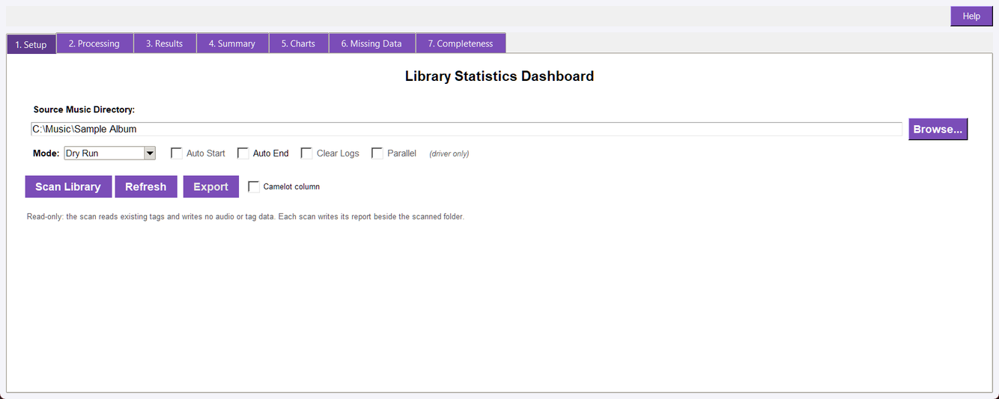
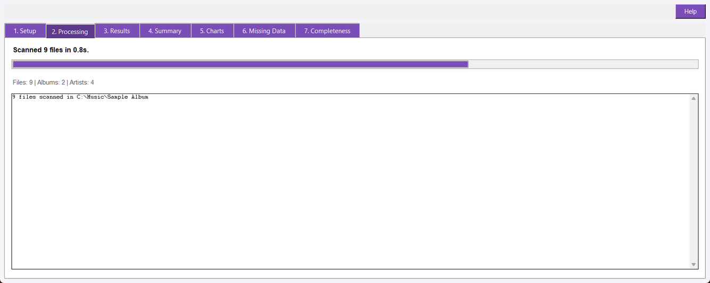
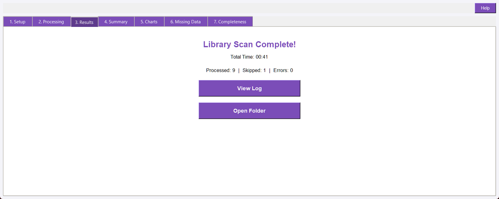

## Overview

Library Statistics Dashboard scans a music library and aggregates metadata that is already present in audio tags. It is read-only: it does not analyze audio, detect new values, or write tags. The dashboard shows summary counts, charts, missing-data lists, and tag completeness results.

The window has eight tabs: Setup holds the folder, the scan mode and the actions; Processing shows the scan's progress and status; Results appears when a scan finishes, with the counters, the run report and the scanned folder; and Summary, Charts, Missing Data, Completeness and Artwork Gaps hold the dashboard itself.

## Quick Start

1. Open Library_Stats.pyw.
1. On the Setup tab, select a music folder or use the restored last folder.
1. Leave Mode on Incremental Scan for normal repeated scans; choose Full Scan to rebuild the cache, or Direct Scan to ignore it.
1. Click Scan Library.
1. Open the Results tab to see the counters, then review Summary, Charts, Missing Data, Completeness and Artwork Gaps.
1. View Log opens this scan's report; Open Folder opens the scanned folder.
1. Use Export, Save CSV, or Save JSON when you need a report outside the dashboard.

## Scanning

- **Recursive walk: **The scanner walks the selected directory tree and includes supported audio extensions.
- **Read-only tags: **It reads BPM, key, genre, mood, tempo marking, album artist, artist, album, and release year values.
- **Formats: **The format breakdown is based on supported file extensions, including MP3, FLAC, OGG, M4A, Opus, WAV, and AIFF variants.
- **Unreadable files: **Files that cannot be read are skipped from tag aggregation rather than stopping the complete scan.
- **Background scan: **The GUI scans on a worker thread and updates the dashboard when complete.

## Mode, Cache and Refresh

The optional cache is a SQLite database at ~/.audiosuite/library_cache.db. It stores raw tag values, file metadata, modification times, and paths. With the cache in use, unchanged files whose modification time matches the cache can be reused without rereading their tags. The report is still aggregated from the complete current cache scope.

The run-controls strip's Mode is the one control for this choice; the Master Driver's `--incremental` and `--refresh` flags seed it.

- **Incremental Scan: **The default. Uses the cache for faster repeated scans; changed files are reread and stale rows are removed. The cache also stores each file's artwork coverage, so a repeat scan reports it without reopening an unchanged file - a cache written by an earlier version is reread once to fill that in.
- **Full Scan: **Clears cached entries for the selected directory and rebuilds them from the files currently present. The Refresh button selects this mode and starts the scan in one click.
- **Direct Scan: **Reads the library directly, without using the SQLite cache at all.

The strip also carries Auto Start and Auto End, which mirror the Master Driver's orchestration options. Auto Start is driver-only, and a launch from the driver locks the strip so the inherited values stay visible but cannot be changed inside the tool. When Auto End is set, the window closes shortly after a scan finishes.

## Results Tab

When a scan finishes, the window switches to the Results tab. It shows the completion heading, the total scan time, the shared **Processed / Skipped / Errors** counters, a View Log button and an Open Folder button. The file, album and artist counts are on the Summary tab, described below.

Every scan writes its report into the folder it scanned, as `library_stats_scan_log.txt`. The report opens with `LIBRARY STATISTICS REPORT`, the Mode, the scanned folder, the cache settings and a rule; then the format breakdown and missing-tag counts; and closes with a SUMMARY block holding the counters, the scan time and the elapsed time. Each scan overwrites the previous report. View Log opens it; the program's diagnostic log under `logs/` is a separate file and is not what the button opens.

## Summary Tab

Summary shows total files, distinct albums, album artists, track artists, and scan duration. It also shows format counts, a major/minor key split, and the top artists by file count.

## Charts Tab

When matplotlib is installed, Charts displays a top-genre pie chart, BPM distribution histogram, top-key bar chart, and release-year distribution, plus an Artwork Coverage panel and the completeness trend. Artwork Coverage counts the files that embed a cover picture against the rest of the library and prints the percentage, so a gap in the artwork is visible beside the tag distributions; it uses the counts the scan already measured, so it costs no second read. If matplotlib is unavailable, the tab reports the installation requirement instead.

## Missing Data Tab

Missing Data reports counts and percentages for files without BPM, key, genre, mood, tempo marking, or embedded artwork. The artwork figure comes from the same cache an incremental scan reads, so it reflects covers that were already measured rather than a fresh extraction pass. It uses the total scanned file count as the denominator and displays a simple visual bar for each missing-data percentage.

## Completeness Tab

Completeness separately checks whether each supported field is present: Title, Artist, Album, Track Number, Year, BPM, Key, Genre, Mood, Tempo Marking, Album Art, and ReplayGain. It shows total, present, missing, and percentage-complete values for each field, plus an overall percentage across all fields.

- **Green: **More than 80 percent complete.
- **Amber: **50 through 80 percent complete.
- **Red: **Below 50 percent complete.
- **Missing files: **The tab lists the specific files missing each field; unreadable files count as missing for completeness purposes.
- **Missing tags by album: **A heatmap under the tag bars shades every album by the percentage of its files missing each tag, with the worst albums at the top. Files without an album tag are grouped together as (no album).
- **Completeness exports: **Save CSV writes the per-tag table; Save JSON includes the full report, the per-album tallies, and missing-file lists.

## Completeness Trend

Each scan records a completeness snapshot in the Library Statistics cache, and the Charts tab draws the overall percentage over time. A snapshot identical to the previous one for the same folder is not recorded again, so opening the dashboard repeatedly does not pad the trend, and only the newest 100 snapshots per folder are kept. Use --trend on the command line to print the series and --no-history to scan without recording a snapshot.

## Artwork Gaps Tab

Artwork Gaps lists the albums whose files are missing embedded artwork, worst-covered first, with how many of each album's files are affected. The list comes from the completeness scan, so opening the tab costs no second read of the library.

**Extract Covers** writes a cover beside each listed album, taken from the picture a file in that album already has: a folder needs one cover, so the first file carrying artwork supplies it and the sidecar is `cover.jpg` or `cover.png` according to the image's own format. An existing sidecar is kept unless the run replaces it, because a curated cover is the better copy. An album where no file has artwork is reported as `NO ART` and nothing is written; **Dry Run** reports the same outcome without writing anything. The pass changes no audio and no tags.

The tab shows one line per album as the pass finishes and writes `library_stats_artwork_log.txt` into the scanned folder; **View Artwork Log** in this tab opens that report. It is a separate file from the scan report the Results tab opens, because the two runs are separate.

## Statistics and Binning

- **BPM: **Grouped into <60, 60-79, 80-99, 100-119, 120-139, 140-159, 160-179, and 180+ bins.
- **Keys: **Aggregated by exact key text and classified into major/minor where the notation is recognized.
- **Moods: **Semicolon-separated mood values are counted as individual mood labels.
- **Years: **Parsed years are grouped into decade labels; missing or unparseable years are Unknown.
- **Albums: **Distinct artist/album pairs are counted as albums.

## Exports

After a scan, Export lets the GUI save the same scan in four shapes, chosen by the file extension you give the dialog. The CSV is intended for spreadsheet use; JSON contains the serialized StatsReport, including distributions, missing-data counts, top lists, and scan details. Completeness has separate CSV and JSON export buttons.

| Format | What it is |
| --- | --- |
| CSV | One row per file, for a spreadsheet |
| JSON | The full StatsReport, for a script |
| M3U | An extended M3U playlist a player opens |
| HTML | A self-contained table page, with no external assets |

The **Camelot column** checkbox adds the harmonic-mixing code for each file's key to the CSV and HTML exports.

The CSV and HTML exports also carry the artwork facts: `has_art` (yes/no),
`art_bytes`, `art_width` and `art_height`. They are read from the file's own
embedded picture, not from a sidecar, so the columns tell you which albums still
need a cover; an unrecognised or absent picture leaves the size columns empty and
`has_art` as `no`. They are appended after the original columns, so a spreadsheet
that reads by name keeps working.

### Playlists and Playlist Order

An M3U export opens with the `#EXTM3U` header, then one `#EXTINF` line (playing time in seconds and `Artist - Title`) and one path per file. Paths are absolute and use forward slashes on every platform, because some players reject a backslash path. An unknown duration is written as -1 rather than 0.

Files are written in playlist order — album artist, then album, then track number, then filename — not in directory-walk order, so an album does not shuffle. A file with no track number sorts after the numbered files in its album, and a file with no tags at all is still listed by its filename.

### The Camelot Wheel

The Camelot code is a pure mapping from the key the Key Detector already wrote, so nothing extra is analyzed:

| Key | Camelot | Key | Camelot |
| --- | --- | --- | --- |
| C | 8B | Am | 8A |
| Ab | 4B | Fm | 4A |
| D | 10B | Bm | 10A |
| Ebm | 2A | F# | 2B |

Both spellings of an enharmonic pair map to the same code (G#/Ab, D#/Eb, A#/Bb), and a file with no key — including one the Key Detector deliberately left untagged — gets an empty code rather than a plausible one.

### Choosing Columns

The command line can choose the columns (`--export-columns path,artist,title,camelot,has_art`) and adds the Camelot column with `--camelot`. The CSV export keeps its original columns unless you ask for a set; `--camelot` alone appends one column to that original set rather than replacing it. The M3U export has no columns to choose, and asking for them is an error rather than a silently ignored flag.

## Command Line

The registered command is stats. Examples:

python -m audio_suite_shared.cli_app stats <folder>\
python -m audio_suite_shared.cli_app stats <folder> --incremental --json\
python -m audio_suite_shared.cli_app stats <folder> --refresh --export-csv report.csv\
python -m audio_suite_shared.cli_app stats <folder> --completeness --detail bpm\
python -m audio_suite_shared.cli_app stats <folder> --trend --history-limit 24\
python -m audio_suite_shared.cli_app stats <folder> --export-json report.json\
python -m audio_suite_shared.cli_app stats <folder> --export m3u\
python -m audio_suite_shared.cli_app stats <folder> --export csv --export-columns path,artist,title,key,camelot\
python -m audio_suite_shared.cli_app stats <folder> --export html --camelot --export-path report.html

Options include --incremental, --refresh, --export-csv, --export-json, --export m3u|csv|html, --export-path, --export-columns, --camelot, --completeness, --detail title|artist|album|track_number|year|bpm|key|genre|mood|tempo_marking|album_art|replaygain, --trend, --history-limit, --no-history, and --json. The CLI prints aggregate counts, format breakdown, missing-data percentages, optional completeness, and the recorded trend when asked for it.

--export writes one artefact per run: the M3U playlist, the column-aware CSV, or the HTML page. Without --export-path it is written inside the scanned folder as <folder-name>_library.<ext>, and the written path is reported. The export runs before the --json branch, so --json and --export can be combined.

## Troubleshooting

- **No files found: **Select the correct folder and confirm it contains supported audio files in the directory tree.
- **Charts are unavailable: **Install matplotlib in the active environment; Summary, Missing Data, and Completeness do not depend on charts.
- **Counts look stale: **Click Refresh to clear the selected directory's cache and rebuild it from current files.
- **A tag appears missing: **The dashboard only reports existing readable tags; run the relevant analyzer or tagger first if the field has not been created.
- **Export is disabled: **Complete a scan before exporting. Empty reports cannot be exported from the GUI.
- **A playlist is in the wrong order: **Order is album artist, album, track number, then filename. A file with a missing or non-numeric track number sorts after its numbered siblings; tagging the track numbers fixes the order.
- **A Camelot column is empty: **The file has no key tag, or the Key Detector found none worth tagging. Run the Key Detector first.
- **An export column is rejected: **Only the documented columns exist. A misspelt name fails with the list rather than producing a file missing the column you asked for.

## Read-Only Safety

Library Statistics only reads audio metadata and writes reports or cache data. It does not modify audio files or tags. The cache is separate from the library and can be refreshed or cleared for the selected directory.
