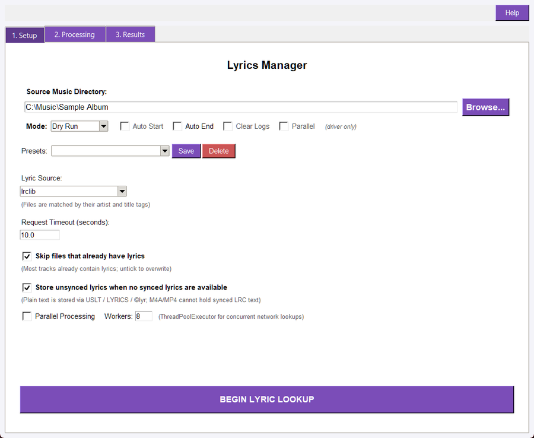
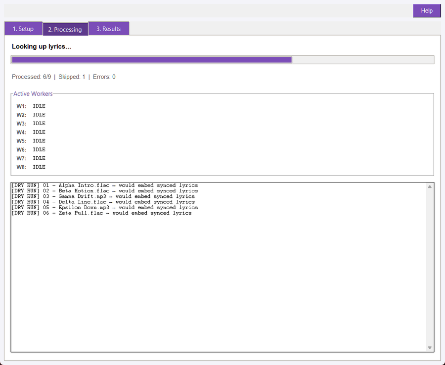
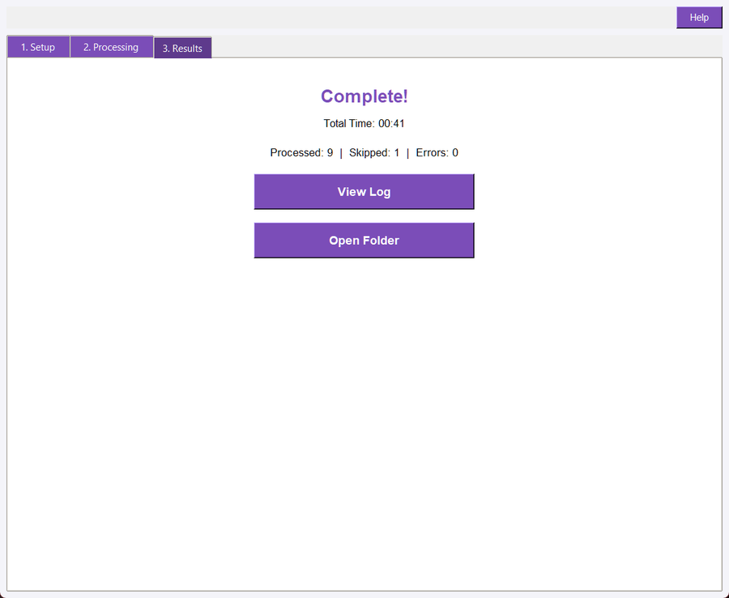

## Overview

Lyrics Manager scans a directory of audio files, fetches synced lyrics from a remote source or a local sidecar file, and embeds them straight into each file's tags, so lyrics travel with the file to any player or device that supports them. Files are matched to the lyric source by their artist and title tags; files whose tags are missing or contain "Unknown" are skipped.

Lyrics can be synced (timestamped lines, so a player highlights the words in time with the music) or plain (the fallback, when no synced version is available). Where the lyrics are stored depends on the file format:

- **MP3, WAV and AIFF: **synced lyrics embedded as an ID3 SYLT frame; plain lyrics as a USLT frame.
- **FLAC, OGG and Opus: **synced lyrics stored in the SYNCEDLYRICS Vorbis comment, plain lyrics in the LYRICS comment.
- **M4A / MP4: **plain lyrics only, in the \xa9lyr atom — these containers have no standard synced-lyrics field, so the plain fallback is used.

## Quick Start

1. Open Lyrics_Manager.pyw (or click the Lyrics Manager card in the Master Driver ENRICH tab and Open Lyrics Manager).
1. Set **Source Music Directory** to the folder to scan, and pick the **Lyric Source**.
1. Leave **Mode** on Dry Run for the first pass, then click **BEGIN LYRIC LOOKUP**.
1. Review the results in the Processing tab and log, then in the Results tab.
1. Run again with **Mode** set to Live Update when the matches are acceptable so lyrics are written.

## The Lyrics Manager Window

The window has three tabs mirroring the other batch tools in the suite.

### Setup

Setup reads top to bottom in the order a run needs it: the Run Controls strip, the Presets row, the tool's own lookup options, then BEGIN LYRIC LOOKUP. The last directory and every option below are saved in the shared suite configuration and restored next launch.

- **Source Music Directory: **The folder to scan, in the Run Controls strip; **Browse...** opens the folder dialog. Audio Suite's supported formats are scanned (MP3, FLAC, OGG, M4A, Opus, WAV, AIFF and variants).
- **Mode: **Dry Run or Live Update.
- **Auto Start / Auto End: **Honoured when the Master Driver passes them. **Auto Start** is greyed out in a standalone launch because only the driver can request an automatic start; **Auto End** stays editable there, but only a driver launch acts on it.
- **Clear Logs / Parallel: **Marked **"(driver only)"** and greyed out; they mirror the driver's orchestration state. The tool's own concurrency switch is **Parallel Processing** further down the tab.
- **Presets: **The combobox lists saved presets, **Save** stores the current options under a name, and **Delete** removes the selected one. A preset stores the lyric source, the request timeout, both toggles, the parallel setting, the worker count and the run mode.
- **Lyric Source: **The lyric source used for every lookup. Two providers are available: lrclib (default, queries the public LRCLIB API over the network) and sidecar (reads a local .lrc file next to each audio file — no network required). The caption under the list reads **"(Files are matched by their artist and title tags)"**.
- **Request Timeout (seconds): **Seconds to wait per lookup before the file is counted as an error. The default is 10.0 seconds.
- **Skip files that already have lyrics: **On by default, with the caption **"(Most tracks already contain lyrics; untick to overwrite)"**. Re-runs that leave it ticked are fast and idempotent; untick it to refresh lyrics.
- **Store unsynced lyrics when no synced lyrics are available: **On by default. The caption names where the plain text goes - **USLT / LYRICS / ©lyr** - and notes that M4A/MP4 cannot hold synced LRC text.
- **Parallel Processing / Workers: **Tick Parallel Processing to look up several files concurrently with a thread pool (network-bound lookups benefit, unlike CPU-bound BPM analysis); **Workers:** sets the maximum number of concurrent files. Parallel is off by default, and the worker count defaults to one per logical CPU, capped at 8.
- **BEGIN LYRIC LOOKUP: **Starts the run with the options currently shown.

### Processing

Shows live progress: each file is reported as it is looked up and written, with a status label: [TAGGED] when lyrics were embedded, [SKIPPED] when nothing was written (with the reason - no artist/title tags, already has lyrics, or lyrics not found), [DRY RUN] when a lookup found lyrics but nothing was written, or [ERROR] when the lookup or the write failed. The log keeps the full per-file history, and Live Update writes participate in the suite's tag-edit undo batch. A status bar shows overall and per-worker counts while the run is in progress.

### Results

Summarises the run: total files, written, skipped and errors, with the overall status line and a final summary with duration. The tab carries the suite's **View Log** and **Open Folder** buttons.

## How Lookup Works

For each file, Lyrics Manager reads the artist and title tags and asks the chosen provider for a matching track. A file is skipped when:

- its format is not supported,
- its artist or title is missing or "Unknown" (a lookup would be wrong),
- it already contains lyrics and **Skip files that already have lyrics** is ticked,
- the provider has no synced lyrics and **Store unsynced lyrics when no synced lyrics are available** is unticked (no plain-text-only matches are stored when searching for synced lyrics only).

When a synced match is found, the LRC text is embedded in the format's synced field. When only plain text is available and **Store unsynced lyrics when no synced lyrics are available** is ticked, the plain field is used. Reachability or HTTP errors on a single file are counted as errors and do not abort the rest of the run.

Existing unsynced LYRICS comments on lossless files are never replaced by a plain write; the plain LYRICS field is only used by this tool when it is the fallback target for a file being processed.

### Providers

Lyrics Manager ships two lyric sources. The source is chosen in **Lyric Source** on the Setup tab, or with the --provider CLI flag.

- **lrclib (default): **Queries the public LRCLIB API (https://lrclib.net) by artist and title. Requires an internet connection. Returns synced and plain lyrics when available. Transient HTTP errors (429, 500, 502, 503) are retried automatically up to three times.
- **sidecar: **Reads a local .lrc file sitting next to the audio file. The sidecar must have the same filename as the audio file but with a .lrc extension (for example, Track01.mp3 looks for Track01.lrc in the same directory). No network access is needed. The .lrc file can contain standard LRC timestamps [mm:ss.xx] and optional meta tags ([ti:], [ar:], [al:], [by:]).

## Dry Run and Live Update

- **Dry Run: **Fetches lyrics and reports what would be written, with no tag changes.
- **Live Update: **Fetches lyrics and writes them with the shared tag writers, reporting [TAGGED].
- **Undo: **Live tag changes are recorded in the suite's batch undo context.

## Running in a Batch

Lyrics Manager is registered as an enrich tool in the Master Driver, so it can be selected alongside other tools and run via LAUNCH BATCH, run concurrently in parallel mode, and appear in each run's queue progress. The batch runs it after tag-dependent tools so artist/title lookups see up-to-date metadata.

## Troubleshooting

"No supported audio files found in directory": The selected folder contains no MP3/FLAC/OGG/M4A/Opus/WAV/AIFF files. Pick the folder that holds your music.

Everything is skipped: Either your files already contain lyrics (untick **Skip files that already have lyrics**), or their artist/title tags are missing or "Unknown". Fix the artist and title tags first — lookups are only as good as the metadata.

"Could not reach provider" / request timeout errors: The lyric source was unreachable or too slow past the Request timeout. Check your connection and retry; finished files are skipped on the re-run. If you prefer to avoid network lookups entirely, switch to the sidecar provider and place .lrc files alongside your audio files.

Lyrics embed but a player shows nothing: Some players ignore SYLT frames (especially on MP3) or the \xa9lyr atom on mobile apps. Try a player known to support embedded synced lyrics.

## A Note For Technical Users

The same fetch-and-embed operation is available from the command line:

audiosuite lyrics MUSIC_DIR --dry\
audiosuite lyrics MUSIC_DIR --live --parallel --workers 8\
audiosuite lyrics MUSIC_DIR --provider sidecar --live\
audiosuite lyrics MUSIC_DIR --json

Options mirror the Setup tab: --provider (lrclib or sidecar), --request-timeout, --skip-existing/--no-skip-existing, --plain-fallback/--no-plain-fallback, --parallel/--no-parallel and --workers. Runs record an undo batch so tags can be reverted with the undo utility.
