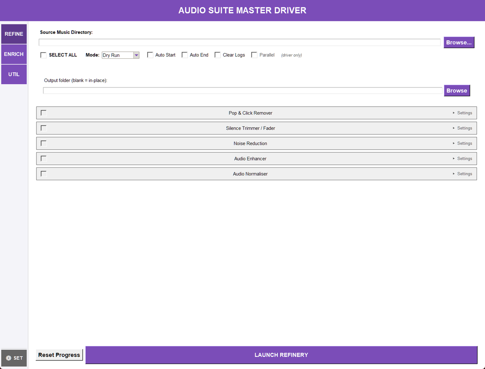

## What the Master Driver Does

The Master Driver is the central desktop application for running Audio Suite tools from one window. It groups the audio-processing Refinery, metadata Enrich tools, and Utility tools behind a shared folder, mode, selection, progress, and settings interface. Tools are discovered from the shared tool registry, so the cards shown by the application reflect the registered suite tools.

## Start the Application

From the AudioSuite-Pro folder, double-click Master_Driver.pyw. The launcher sets the suite folder as the working directory, runs a pre-flight check that compiles first-party Python files, configures logging, applies the theme, and then opens the Master Driver window. A pre-flight failure blocks startup so a broken import or syntax error is reported before the UI begins.

The window title is Audio Suite Master Driver. The application remembers the last directory and saved appearance settings through the shared suite configuration. Closing the window saves the current application state.

## Basic Workflow

Use this sequence for a normal batch operation:

1. Choose the REFINE, ENRICH, or UTIL tab.
1. Select the folder or source and output paths required by that tab.
1. Leave Dry Run selected while checking a new operation.
1. Expand tool cards and set their tool-specific options.
1. Select the tools or Refinery stages to run.
1. Review Auto Start, Auto End, Clear Logs, and Parallel settings.
1. Launch the process and monitor the progress area and log output.
1. Repeat with Live Update only after the dry-run result is acceptable.

## The Main Window

### REFINE

REFINE embeds the Audio Refinery setup. Choose a source folder and, if needed, an output folder. A blank output folder means process in place. Select one or more stages: declick, trim, enhance, normalise, and reduce noise. SELECT ALL changes all five stage selections together. The embedded controls also provide Dry Run, Auto Start, Auto End, and Clear Logs. The Refinery does not use the shared Parallel option. Reset Progress clears the completion record for the selected source so files are eligible for another run. At least one stage and a valid source directory are required. In the enhancement stage, selecting Custom opens the Custom DSP editor the stage itself carries, so the stage stays compact and every control is reachable.

### ENRICH

ENRICH displays the registered tag and metadata tools as cards in a scrollable list, arranged under five captions in the order they support each other:

- **Tag Cleanup** — Metadata Scrubber.
- **Identification** — Audio Fingerprinter.
- **Loudness & Genre** — ReplayGain Analyzer, Album Genre Tagger, Genre Sync.
- **Analysis** — BPM Analyzer, Tempo Analyzer, Key Detector, Mood Analyzer.
- **Artwork & Lyrics** — Album Art Sync, Lyrics Manager.

Check a card to include it, expand Settings when a card has options, and click LAUNCH ENRICH PROCESS. The order on screen is the order a sequential batch runs its steps in, and the captions never change that order: Tempo Analyzer runs after BPM Analyzer because it reads the BPM tag, and the artwork tools run last so a later tag rewrite cannot disturb the artwork. The shared directory bar supplies the folder to process. Tools that open their own window are launched separately from the batch subprocesses.

### UTIL

UTIL displays the registered utility cards and the LAUNCH UTILITY PROCESS button. Most utilities use the shared directory bar. Standalone utilities such as CD Ripper, Library Statistics Dashboard, Tag-Based File Reorganizer, Mood Analysis Batch Tagger, and Undo Tag Edits open their own window or workflow. Undo Tag Edits is opened with its Open Undo button and is not part of a batch run.

Five audio-processing utilities are no longer shipped as separate tools: Pop & Click Remover, Silence Trimmer, Noise Reduction, Audio Enhancer, and Audio Normalizer were retired, so neither their windows nor their launchers nor their own commands exist any more. REFINE runs their work as the declick, trim, reduce noise, enhance, and normalise stages, and REFINE's Dry Run reports what each enabled stage would change. The stages carry the controls those tools had - including the normalise stage's true-peak ceiling, loudness-range target and lossless mode - so nothing needs a second window to be reached.

### SETTINGS

SETTINGS contains the Colour Palette, Theme Mode, and Typography controls. Use Save to persist the choices. The interface reports that saved changes take effect when each tool is next opened. The Windows Accent palette can refresh while the application is running when Windows accent information is available.

## Help Menu

The Help menu opens the documents and notices that ship with the installation:

- **User Guide: **Opens this guide.
- **What's New: **Shows the changes recorded for the installed version.
- **Full Changelog: **Shows every released version's changes, and reports when the installation carries no changelog to read.
- **Licences: **Opens a read-only window listing the licence texts this copy ships, so you can read them without browsing the install folder.
- **About: **Shows the suite's version information.

Licences shows the suite's own GPL-3.0 licence and its third-party notices, plus the GNU LGPL 2.1 text, Chromaprint's notice and the provenance record for the two bundled binaries that the LGPL text covers, fpcalc.exe and discid.dll. The list is what the copy actually carries: an installed build reads its licenses folder, and a source checkout reads the same files from the packaging folder, so the entry works before an installer exists. A text that is present but cannot be opened is reported rather than silently skipped, and a build that carries no texts says so instead of opening an empty window. The window itself is read-only. Open in default app hands the selected file to your usual viewer if you want to keep or print it, and the command line can print the same texts with audiosuite licences.

## Shared Run Controls

- **Folder: **The shared directory used by ENRICH and directory-based UTIL tools. Use Browse Folder or enter a path, then confirm that it exists.
- **SELECT ALL: **Selects or clears the available cards in the current batch-oriented area. In REFINE it controls the five Refinery stages.
- **Mode: **Dry Run previews the operation without committing changes. Live Update permits the selected tool to write tags or files.
- **Auto Start / Auto End: **Passes the corresponding start and end processing options to supported tools.
- **Clear Logs: **Requests log cleanup before the selected run begins.
- **Parallel: **Allows independent Enrich or Utility subprocesses to run concurrently. Dependency-aware scheduling still preserves required ordering.
- **Progress area: **During a batch run, the driver can show per-step status, an overall summary, estimated remaining time, and a progress bar.
- **Step notes: **A step can finish with something the run still owes you - CD Ripper tracks that did not rip, files a tag writer skipped or could not update, conversions skipped or failed. The driver prints that on the step's own line, and keeps the report on screen while it carries a note instead of hiding it when the batch ends. A note never means the step failed: the work it did was done.
- **Batch verdict: **When a finished batch recorded caveats, the report closes with one line naming every tool that reported one, in run order - for example, Batch verdict: 2 of 12 steps completed with caveats - BPM Analyzer: 2 of 12 tracks measured outside the 75-175 BPM range. Failed steps are counted at the start of that line. A long list of caveats is shortened with a count of how many were left out; each full note stays on its own step line.

## Enrich Tools

- **Metadata Scrubber: **Removes metadata while offering preservation choices for lyrics, Album Artist, and embedded artwork.
- **Audio Fingerprinter: **Generates fingerprints and identifies tracks through AcoustID. New card options cover AcoustID lookup, writing matched tags, the minimum match threshold, the fpcalc analysis window, an explicit fpcalc binary path, and a one-off API key.
- **ReplayGain Analyzer: **Measures and writes ReplayGain tags using a reference LUFS value.
- **Album Genre Tagger: **Builds album-level genre metadata with a minimum coverage percentage.
- **Genre Sync: **Copies genre information from the configured custom-field hierarchy.
- **BPM Analyzer: **Detects BPM within a configured range and analysis duration, with optional worker parallelism.
- **Tempo Analyzer: **Derives tempo markings from BPM tags using the selected naming scheme.
- **Key Detector: **Detects musical key for each file, with analysis duration and optional worker parallelism.
- **Mood Analyzer: **Performs signal-based mood tagging with configurable duration and worker parallelism.
- **Album Art Sync: **Embeds and synchronises artwork using maximum resolution, minimum dimension, purge, and album-match settings.
- **Lyrics Manager: **Imports and exports synced (LRC) lyrics for a single audio file: MP3, WAV and AIFF use the ID3 SYLT frame while FLAC, OGG and Opus store the text in a SYNCEDLYRICS Vorbis comment.

## Utility Tools

The cards are grouped under six captions, in workflow order: Convert & Import, Tags & Artwork, Analysis & Inspection, Repair & Processing, Organise & File Handling, and Plugins last. Cards are alphabetical inside a group, and a caption always starts a fresh row. The order on screen is the order a sequential batch runs its steps in.

### Convert & Import

- **ASX Playlist Extractor: **Extracts audio streams from ASX playlist files, restores files replaced by a Duplicate Finder stub, and can include subfolders; Live Update uses permanent extraction.
- **CD Ripper: **Rips CDs to WAV, MP3, FLAC, OGG, M4A, or Opus with MusicBrainz metadata lookup. Card options cover the output directory, output format, a specific track list, and CUE sheet generation.
- **Music Format Converter: **Detects the input format, then converts to a selected output format and quality. Card options add sample rate, bit depth, MP3 normalisation target LUFS, an optional output directory, and delete-originals. Subfolders are scanned and mixed source formats are accepted, and the output-format list narrows to what the detected inputs can actually reach.

### Tags & Artwork

- **Album Art Normalizer: **Resizes and normalizes embedded artwork with a selectable target size and supports folder.jpg normalization.
- **Tag Editor: **Edits common tags in an interactive grid. The driver passes its directory, mode, auto-start and auto-end settings to the window, so a batch cannot be rewritten mid-run.
- **Tag Field Updater: **Scans and updates tag fields.
- **Undo Tag Edits: **Restores tags from snapshots recorded before batch edits.

### Analysis & Inspection

- **Library Statistics Dashboard: **Reads existing tags and presents read-only library statistics. Card options select a full or incremental scan, cache refresh, and CSV/JSON export paths.
- **Mood Analysis Batch Tagger: **Recursively analyses audio and applies signal-based batch mood tags.
- **Spectral Viewer: **Renders and exports FFT spectrograms of the selected files.

### Repair & Processing

- **Channel Tools: **Applies mono, dual-mono, phase, mid/side and width rules in place.
- **Duplicate Finder: **Finds duplicate recordings by fingerprint and quarantines, deletes or stubs the extras.
- **ML Denoiser: **Neural noise reduction with RNNoise, which is trained on speech.
- **Restoration (Declip): **Reconstructs flat-topped peaks lost to clipping.
- **Stem Separator: **Separates tracks into vocals, drums, bass and other stems.

### Organise & File Handling

- **Audio Joiner: **Joins a folder's files into one output in the order you set, with gaps or equal-power crossfades at the boundaries.
- **Tag-Based File Reorganizer: **Moves or copies files into a folder hierarchy based on tags, with configurable output directory, action, and artist-specific and Various Artists patterns.
- **Track Splitter: **Splits recordings into tracks at their silent gaps.

### Plugins

- **Example Tool: **The bundled example plugin's card, kept as a worked demonstration of the plugin system. It is enabled by default; turn it off in the plugin preferences if you do not want it in the tab.

## Batch Execution

The driver builds a step for every selected registered tool. In sequential mode, steps run in the displayed order. In Parallel mode, independent steps may run together, while declared dependencies are held until their required step completes. Tempo depends on BPM when both are selected. Standalone tools are marked as skipped by the parallel batch path because they open their own interface.

Each step reports pending, waiting, running, completed, failed, or skipped status. The orchestrator retries failed subprocess steps using the suite's retry policy. The final report includes totals, failed and skipped counts, individual step results, and elapsed time.

A step that fails with a transient file-system error (a permission or input-output error) is retried twice: the driver waits two seconds, then four, before trying again. After the second retry the step is marked failed and the batch carries on with the next step, so one locked or unreadable file cannot abandon the rest of the run. A step that never completed shows as failed and carries no note, because there is no finished work to caveat. The one ordering the driver imposes is declared rather than learned: Tempo waits for BPM when both are selected.

A step whose required step did not succeed is skipped rather than started, in both sequential and Parallel mode. Its line gives the reason: skipped: dependency 'bpm' failed when BPM ran and failed, or did not run when BPM was itself skipped. Starting Tempo against files BPM never tagged would write a tempo marking derived from nothing and report the step as completed, which is why the dependant is refused instead.

While a batch runs, the control strip shows the current step (for example, Step 2 of 6: Mood Analyzer), a progress bar, and the elapsed time with an estimate of the rest. The estimate is the average duration of the steps that have already finished multiplied by the number still to run; after a first batch, the per-tool durations the driver records in audio_suite_config.json (under tool_durations) let it show an estimate before any step has finished on later runs. The progress widgets appear when the batch starts and hide when it completes.

## Safe Operating Practices

- Use Dry Run first, especially for conversion, reorganization, artwork changes, and metadata cleanup.
- Keep a backup of important audio files before Live Update or any operation that moves, copies, deletes, or overwrites files.
- Confirm the directory path before launching. The driver validates that required directories exist.
- For conversion, review the detected input format, output format, quality, output directory, and delete-originals setting.
- Do not close the application while a batch is running unless you accept that child processes may be interrupted.
- Use Undo Tag Edits for supported tag-edit snapshots after a batch run; it does not undo audio processing or file moves.

## Troubleshooting

- **The process will not start: **Select the required directory, verify that it exists, and select at least one tool or Refinery stage.
- **A card is missing: **The card is loaded from the registry and its card module. Check the application log for an import or card-build warning.
- **A standalone tool does not run in the batch: **Open it from its card. Standalone tools are designed to launch their own window and are not ordinary blocking batch steps.
- **The output is unchanged: **Confirm that the run was Live Update rather than Dry Run, and check the per-step status and logs for failures or skips.
- **Startup is blocked: **The launcher pre-flight check found a compile or import-chain problem. Correct the reported source or dependency issue, then start the launcher again.

## Related Launchers

Every registered tool also has its own suite launcher where one exists. The Master Driver uses the registry's script filename and category to decide how to launch it; direct launchers are useful when a tool needs its own dedicated workflow or window.

The five DSP utilities REFINE absorbed are the exception: they no longer have launchers of their own. Their full option sets live on REFINE's stages - the Custom DSP editor on the enhancement stage, and the true-peak, loudness-range and lossless controls on the normalise stage - and the command-line route is audiosuite refine with the stage selected.
