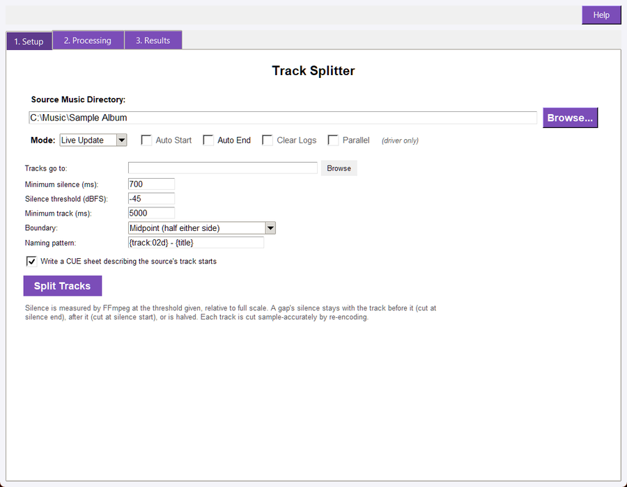
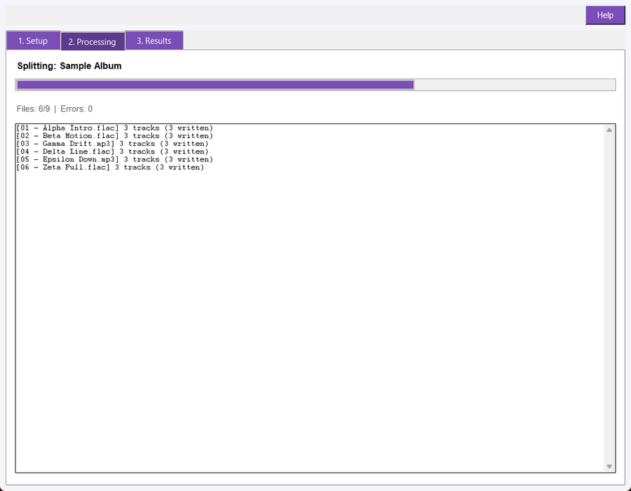
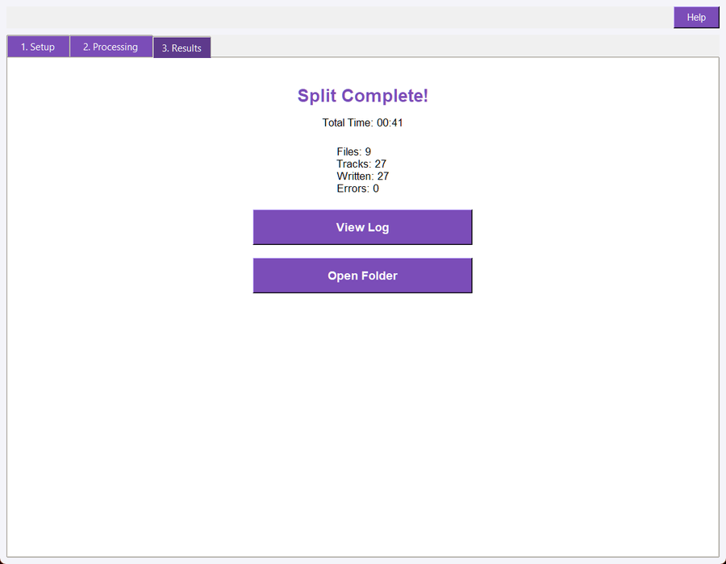

## Overview

Track Splitter takes a folder of recordings and cuts each one into tracks at its
silent gaps. A live set, a vinyl side, a cassette rip or a long rehearsal file
becomes numbered files in a `split` folder beside the source, with a CUE sheet
that records where each track began in the original.

The split is a re-encode: the tracks are decoded, sliced at the sample and
written out at the source's own depth, so a 24-bit FLAC stays 24-bit. Because the
outputs are new files, the tool never modifies, moves or retags anything it
reads, and a Dry Run writes nothing at all.

The window has three tabs: Setup holds the folder, the split settings and the
actions; Processing shows the run's progress and a status line per source; and
Results appears when the run finishes, with the counters, the run report and the
output folder.

## Quick Start

1. Open Track_Splitter.pyw.
1. On the Setup tab, select the folder holding the recording, or use the restored last folder.
1. Leave the detection settings as they are if the recording has clear gaps between songs; see **Detection Settings** when it does not.
1. Click **Split Tracks**.
1. Watch the Processing tab: each source reports how many tracks it was cut into and how many files were written.
1. View the Results tab for the totals, then open the `split` folder to check the filenames and the first and last track.

A Dry Run on the same folder reports the same counts and writes nothing, so it
is the way to check the settings before a long run.

## Setup Tab



- **Source folder: **The folder to scan. It is searched recursively for the supported audio extensions, so a disc-per-subfolder library works.
- **Output folder: **Where the tracks are written. The default is `split/` inside the source folder; any other folder is accepted, and it is created when it does not exist.
- **Detection settings: **The minimum silence length, the silence level, and the minimum track length. See below.
- **Boundary: **Where inside a silent gap the cut lands.
- **Naming pattern: **The output filename pattern.
- **Write a CUE sheet: **On by default; see **CUE Sheet**.
- **Dry Run / Live: **Live writes the tracks; Dry Run plans them and reports the plan without touching the disk.

## Detection Settings

The gaps come from FFmpeg's own `silencedetect` filter, so the two levels are
measured on the decoded audio rather than guessed from the waveform display.

- **Minimum silence (700 ms): **The shortest run of silence treated as a boundary. A shorter dip - a breath between phrases, a quiet bar - is part of the track and never cuts it. Lower it for recordings with short gaps, raise it when a quiet passage is being mistaken for a break.
- **Silence level (-45 dBFS): **The level at or below which audio counts as silence, relative to full scale. A hissy cassette rip may need a higher threshold (-40 or -35); a recording with a quiet outro may need a lower one.
- **Minimum track (5000 ms): **The shortest track kept. A fragment shorter than this is merged into its neighbour rather than written on its own, so a stray silence in the middle of a song cannot produce a two-second file. It is never dropped: every second of the source ends up in some track.

The source's own leading and trailing silence is discarded rather than written as
a track, so track one starts with music instead of half a second of room tone.
The run report states how much silence was discarded. A file that is silent
throughout is refused with that reason instead of producing a silent track.

## Boundary Rules

A silent gap has to become a cut somewhere. The **Boundary** setting chooses
where:

- **Midpoint (default): **The cut lands halfway through the gap, so each track keeps half of the silence that separated it. This is the safest choice for a continuous live recording, because a track never starts with a fade-in and never ends mid-note.
- **Start: **The cut lands at the gap's first sample, so the silence stays with the track before it. Use it when the recording is a set of takes and the trailing silence belongs to the take.
- **End: **The cut lands at the gap's last sample, so the silence opens the following track. Use it when a track's count-in matters.

Whatever the rule, the cuts partition the audio: the track durations plus the
discarded leading and trailing silence add up to the source's length, so no
sample is lost and none is written twice.

## Naming and Tags

The naming pattern's default is `{track:02d} - {title}`, which produces
`01 - Song.flac`. These fields are available:

- `{track}` - the track number; `{track:02d}` pads it, and without the format spec it is unpadded.
- `{title}` - the source's title, or the source's filename stem when it has none.
- `{album}` and `{artist}` - the source's album and artist values, empty when the file has none.

The source's extension is kept, so a FLAC source yields FLAC tracks. A pattern
that would name a track after the source file itself is refused with a message,
because that would overwrite the recording being split; change the output folder
or the pattern.

Track numbers restart at 1 for each source file, and each source is split into
its own set of files. The written tracks carry no new tags: the split copies
audio, and tag copying is a separate step (`audiosuite tag-update` or the Tag
Editor).

## CUE Sheet

With **Write a CUE sheet** on, the run writes `<source name>.cue` beside the
tracks. The sheet describes the **source file**, not the individual tracks: one
`FILE` entry for the original recording and one `INDEX 01` per track start, so it
can be used to re-create the split, to burn the recording as one image with
track marks, or to check where each cut landed.

CUE sheets store positions in CD frames (75 per second), so a written offset can
differ from the exact sample position by up to one frame, about 13 ms. This is a
property of the format, not of the split. Turn the option off with `--no-cue` in
the CLI or by clearing the checkbox when only the audio files are wanted.

## Processing Tab



The Processing tab reports the run as it happens: a progress bar over the
sources, the `Files: done/total | Errors: n` counters, and one line per finished
source in the form `[<source>] N tracks (M written)`. A Dry Run shows `0 written`
on every line, because a dry run writes no audio. A source that cannot be
decoded is reported on its own line and the run continues with the next one; the
Results tab's Errors counter includes it.

## Results and the Run Report



When a run finishes the window switches to the Results tab. It shows the
completion heading, the elapsed time, the shared **Files / Tracks / Written /
Errors** counters, a View Log button and an Open Folder button for the output
folder.

Every run writes `track_splitter_split_log.txt` into the folder it scanned. The
report opens with `TRACK SPLITTER REPORT`, the Mode, the source folder, the output
folder, the detection settings and a rule; then one line per source with its
track count and the files written; and closes with a `SUMMARY:` block holding the
counters, the discarded silence and the elapsed time. View Log opens that report.
The program's diagnostic log under `logs/` is a separate file and is not what the
button opens.

A Dry Run writes the same report with `Mode: DRY RUN` and `Written: 0`, which is
how a planned run is kept as a record.

## Command Line

```bash
audiosuite split "D:\Music\Live" --dry
audiosuite split "D:\Music\Live" --output-dir "D:\Music\Live\tracks" --live
audiosuite split "D:\Music\Live" --min-silence 400 --silence-db -40 --min-track 2000
audiosuite split "D:\Music\Live" --boundary start --naming "{track:02d} {title}"
audiosuite split "D:\Music\Live" --no-cue --json
```

The Master Driver passes the folder, the mode and the detection settings to the
window, so a driver batch run and a standalone launch split the same way.

## Troubleshooting

**A file was reported with one track and no gap found.** The recording has no
silent run long enough for the current settings. Lower **Minimum silence**, raise
**Silence level** toward zero (for example -40 dBFS), or both. Run the Dry Run
first: the report lists the track count per file, so a wrong setting is visible
before anything is written.

**Two songs ended up in one track.** The gap between them was shorter than
**Minimum silence** or quieter than the setting is not silent enough. Lower the
minimum silence to the shortest real gap in the recording.

**A track is a fragment.** The fragment was at least the minimum track length, so
it was kept. Raise **Minimum track** and re-run: the fragment then merges into
its neighbour.

**The run wrote nothing.** The window was in Dry Run mode, or the folder had no
supported audio files. The Processing tab and the run report both state which.

**An existing file was not overwritten.** Re-running a split into the same output
folder writes the tracks again, replacing files with the same names. Point a
re-run at a fresh output folder when the old tracks are still needed.

**The tracks do not line up with the CUE sheet to the sample.** They cannot: the
sheet stores CD frames. A one-frame difference (about 13 ms) is expected. Larger
differences mean the sheet and the audio came from different runs.

**A 24-bit source produced 16-bit tracks.** Check that the output extension
matches the source: a pattern or output folder that changes the extension changes
the encoder. The splitter pins the depth for lossless containers, so WAV, FLAC
and AIFF keep their bit depth.
